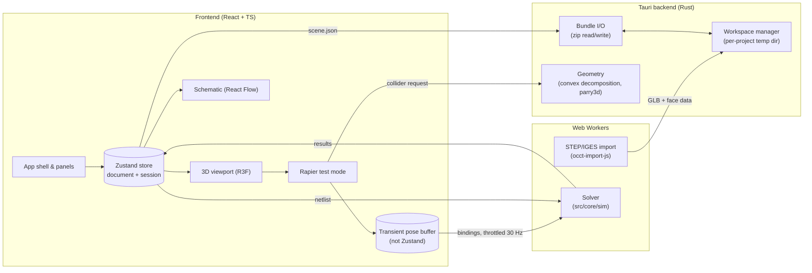

# StudioVD: Architecture & Implementation Plan

Status legend: `[x]` done and verified · `[ ]` to do · ⛔ = **stop and get user approval**.

---

## 0. Phase overview

| # | Phase | Outcome you can test |
|---|---|---|
| 1 | Setup & planning | Tauri + React-TS scaffold builds; `CLAUDE.md`, `PLAN.md` |
| 2 | UI scaffolding & state | Full app shell with resizable panels, menu bar, store, undo/redo |
| 3 | Core 3D & physics spike | Grid, lights, CAD camera; two blocks on a hinge, mouse-drag blocked by collision |
| 4 | Import pipeline | GLB/OBJ/STL/STEP/IGES parts appear in viewport + scene tree, in mm |
| 5 | Project bundle | Save/open `.stvd` round-trips exactly |
| 6 | Materials | PBR library + editor; metal, plastic, glass look right |
| 7 | Anchors | Click a face/hole/vertex to place an anchor frame; hole axes auto-detected |
| 8 | Mates & snapping | Pick two anchors and a type: parts snap together, DOF shown |
| 9 | Kinematic test mode | Drag imported assemblies; joints + collisions hold at 200 parts |
| 10 | Schematic editor | Domain-typed nodes/ports, validated wiring, black-box sub-blocks |
| 11 | Simulation engine | Steady-state multi-domain solve with gravity loads; values on wires |
| 12 | 3D ↔ simulation bindings | Dragging a hinge changes the sim; sim lights an LED in 3D |
| 13 | Hardening & release | CSP, perf pass, CI, installers |

Phases 4 → 13 are my proposed order (you specified 1-3). Save/load (5) is deliberately early
so every later feature is persisted and testable with fixture projects from day one.

---

## 1. Architecture



### 1.1 Key decisions (and why)

1. **Document / session / transient state split** (details in `CLAUDE.md` §4). Physics poses
   update at 60 Hz; pushing them through Zustand would re-render React every frame. They live
   in a mutable buffer read inside `useFrame`.
2. **Workspace directory instead of in-memory bundles.** Opening a project extracts it into
   an app-cache workspace; imports write assets there; the viewport loads them via the Tauri
   asset protocol. Save = Rust zips the workspace + `scene.json` (atomic: write temp, rename).
   Large binaries never travel through JSON IPC; crash recovery comes for free.
3. **Geometry is normalized at import into GLB** (mm, Y-up, recentred, normals present),
   content-addressed by SHA-256. Parts *reference* an asset, so the same STL imported twice is
   stored once. One loader path at runtime (GLB) regardless of source format.
4. **Design mode vs. test mode.** Design mode: physics paused, parts placed by snapping/gizmo,
   `frameloop="demand"` (idle GPU ≈ 0). Test mode: physics runs from the design pose; on exit,
   *Reset* (default) or *Apply pose* (one undoable commit).
5. **Fixed mates merge parts into one rigid body** (compound collider) instead of a Rapier
   fixed joint. Exact, cheaper, and removes joint drift from the most common constraint.
6. **Collision proxies, not render meshes.** Rapier trimesh colliders are hollow and unreliable
   between dynamic bodies, and its JS build has **no convex decomposition** (verified in
   `@dimforge/rapier3d-compat` 0.19.2). So: grounded bodies may use trimesh; dynamic bodies use
   convex hull (default) or convex decomposition computed in Rust (`parry3d`), cached in the bundle.
7. **Mated pairs don't collide by default** (`ImpulseJoint.setContactsEnabled(false)`), and
   pairs already interpenetrating when test mode starts (zero-clearance CAD fits) are filtered
   with `useFilterContactPair` (verified present in `@react-three/rapier` 2.2.0) and reported.
   Without this, a shaft modelled exactly in its bore makes the assembly explode on start.
8. **Mouse drag = force-limited spring, not teleport.** Each physics step applies an impulse
   toward the cursor target at the grab point, clamped to a max force, with CCD on. When a
   collision blocks the part, the spring just stretches; the part stays blocked. Setting
   positions directly would tunnel through other parts.
9. **Simulation = steady-state, multi-domain, effort/flow formulation** (see §3).
10. **Every Tauri call goes through `src/lib/tauri/`** so the full UI runs in a browser with
    `mockIPC` for Playwright tests.

### 1.2 Project bundle (`.stvd`)

A zip with a custom extension, `.stvd` (user decision). No registered format uses `.stvd`;
ST Visual Develop ("STVD") uses `.stw`/`.stp`. `.svd` was rejected because CMSIS-SVD
microcontroller register files already use it.

```
MyAssembly.stvd
├── scene.json                         master file (schema-validated, versioned)
├── geometry/<sha256>.glb              normalized geometry, one per unique asset
├── sources/<sha256>.<step|iges|...>   optional originals (re-tessellate at another quality)
├── textures/<sha256>.<png|jpg>
├── colliders/<sha256>-<params>.bin    cached convex decompositions
└── thumbnail.png
```

### 1.3 `scene.json` shape (v1 sketch, finalized as zod schemas in Phase 2/5)

```ts
interface SceneFile {
  format: "studiovd"; schemaVersion: 1; appVersion: string; units: { length: "mm" };
  assets:    Record<AssetId, GeometryAsset>;   // sha256, path, bbox, triCount, faces[], volume, centroid, watertight
  textures:  Record<TextureId, { path: string; sha256: string }>;
  materials: Record<MaterialId, Material>;     // appearance (PBR) + physical { densityKgM3 }
  parts:     Record<PartId, Part>;             // name, assetId, parentId, position, quaternion, materialId,
                                               // grounded, visible, collider: "hull"|"decomposed"|"box"|"trimesh"|"none",
                                               // massOverrideKg?
  anchors:   Record<AnchorId, Anchor>;         // partId, kind: point|planar|axial, frame {origin, z, x} (part-local), source
  mates:     Record<MateId, Mate>;             // type: fixed|revolute|prismatic|spherical, anchorA, anchorB,
                                               // flip, angleOffset, limits?, contactsEnabled, suppressed
  schematic: { nodes: SchematicNode[]; edges: SchematicEdge[]; blockDefs: Record<BlockDefId, BlockDef> };
  bindings:  Record<BindingId, Binding>;       // 3D quantity <-> schematic port/parameter
  simulation:{ gravity: [number, number, number]; solver: SolverSettings };
}
```

---

## 2. Geometry & assembly math (reference for Phases 4, 7, 8, 11)

**Mass properties** of a closed, outward-oriented triangle mesh (divergence theorem); per
triangle $t$ with vertices $\mathbf p_1,\mathbf p_2,\mathbf p_3$:

$$V_t = \tfrac{1}{6}\,\mathbf p_1\cdot(\mathbf p_2\times\mathbf p_3),\qquad V=\sum_t V_t,\qquad \mathbf c=\frac{1}{V}\sum_t V_t\,\frac{\mathbf p_1+\mathbf p_2+\mathbf p_3}{4}$$

Mass $m=\rho V$ (with $V$ converted mm³ → m³, factor $10^{-9}$). Non-watertight meshes are
flagged and require a manual mass.

**Face classification** (for anchor snapping). STEP gives B-rep face triangle ranges but no
surface type; STL/OBJ give nothing, so faces come from normal-angle region growing. For a
face, with area-weighted unit normals $\mathbf n_k$:

$$\mathbf N=\frac{1}{\sum_k A_k}\sum_k A_k\,\mathbf n_k\mathbf n_k^{\mathsf T},\qquad \lambda_1\ge\lambda_2\ge\lambda_3,\quad \lambda_1+\lambda_2+\lambda_3=1$$

Plane: $\lambda_2\approx 0$ (normal = $\mathbf e_1$). Cylinder (hole/shaft): $\lambda_3\approx 0$
and $\lambda_2$ clearly $>0$; **axis = $\mathbf e_3$** (normals are all perpendicular to it).
A full cylinder gives $(\tfrac12,\tfrac12,0)$; an arc of angle $\alpha$ gives
$\tfrac12\left(1\pm\tfrac{\sin\alpha}{\alpha}\right)$ for the first two. Axis position and
radius: least-squares (Kåsa) circle fit of the face points projected onto the plane ⟂ axis.

**Snapping.** $M_A, M_B$ = part world matrices; $F_A, F_B$ = anchor frames in part-local
coordinates; $R_{\text{flip}}$ = 180° about the anchor's local $x$ (face-to-face); $R_z(\varphi)$ =
user angle offset. Part B (and its free sub-assembly) moves to:

$$M_B = M_A\,F_A\,R_{\text{flip}}\,R_z(\varphi)\,F_B^{-1}$$

so that B's anchor lands exactly on A's: $M_B F_B = M_A F_A R_{\text{flip}} R_z(\varphi)$.

**Gravity loads** (simulation only). For a revolute mate with unit axis $\hat{\mathbf a}$ through
point $\mathbf p$, carrying distal parts $i$ (mass $m_i$, centre of mass $\mathbf c_i$):

$$\tau=\hat{\mathbf a}\cdot\sum_i(\mathbf c_i-\mathbf p)\times m_i\mathbf g \qquad\text{prismatic: }\; F=\hat{\mathbf a}\cdot\sum_i m_i\mathbf g$$

**Perspective ↔ orthographic** without a visual jump: at target distance $d$ with vertical FOV
$\theta$, the visible height is $h=2d\tan(\theta/2)$; set the orthographic camera so
$(\text{top}-\text{bottom})/\text{zoom}=h$, and the reverse when switching back.

---

## 3. Simulation model (Phase 11)

- **Steady state only in v1 (confirmed).** Nothing auto-animates, so the natural model is an
  operating point re-solved on every change (edit, parameter, or a bound 3D joint moving during
  a drag). Capacitors are open, inductors shorted. Transient (time-domain) simulation is a
  possible later phase; keep the component interface open for it (no steady-state-only
  assumptions baked into port or netlist types).
- **3D ↔ sim coupling (confirmed):** 3D → sim carries *measurements* (joint angle/position,
  mass, gravity torque, part-contact state); sim → 3D carries *visuals only* (LED glow, tint,
  force arrows). The simulation never moves parts.
- **Two port classes:**
  - *Conserved (acausal) domains*: an across ("effort") and a through ("flow") variable.
    Connected ports share effort; flows sum to zero at each net (Kirchhoff).
    Electrical $V/I$, fluid $p/Q$, mechanical translational $v/F$, rotational $\omega/\tau$.
    Solved together by **Modified Nodal Analysis** + Newton-Raphson for non-linear parts (LED,
    diode), dense LU (fine at this scale; sparse only if benchmarks demand it).
  - *Signal (causal) domains*: **data** and **light**. Directed output → input, evaluated in
    topological order; feedback loops iterate to a fixed point or are reported.
- **Power is derived, not wired:** $P = e\cdot f$ per port ($VI$, $pQ$, $Fv$, $\tau\omega$).
  I'm pushing back on "power" as its own flow domain: making it independent would let the
  model violate energy conservation.
- **Cross-domain components** couple domains inside one solve, e.g. DC motor
  ($\tau=k_t I$, $V_b=k_e\omega$), hydraulic cylinder ($F=pA$), LED (electrical → light),
  photodiode (light → electrical/data), pump, solenoid.
- **Gravity** enters only as mechanical sources computed from 3D mass properties (§2). The
  Rapier world stays at zero gravity.
- **Black-box sub-blocks** (PCBs, controllers): user-defined ports (name, domain, direction,
  unit) plus behaviour from a small sandboxed expression language (e.g. `out = vin > 2.5 ? 1 : 0`,
  `I_draw = 0.12`). No gerber/internal tracing.

---

## 4. Risks & mitigations

| Risk | Mitigation |
|---|---|
| Impulse joints are slightly soft and drift under strong drag forces | Force-clamped drag spring, more solver iterations, fixed mates merged into rigid bodies; headless drift tests |
| Thin parts tunnel when dragged fast | CCD on dynamic bodies + velocity clamp |
| Zero-clearance CAD fits interpenetrate at start | Contacts off for mated pairs; start-of-test interference scan → filtered + reported |
| Rapier JS joints and arbitrary part orientations: a hinge may "jump" if local frames are wrong | Phase 3 headless test creates a hinge between differently-rotated bodies and asserts zero initial correction (`JointData.frame1/frame2` exist; behaviour to be verified) |
| WebView differences: Windows uses WebView2 (Chromium, strong WebGL); Linux uses WebKitGTK (the weakest WebGL host, some GPU/driver combos need `WEBKIT_DISABLE_DMABUF_RENDERER=1`) | WebGL2 only; E2E runs on Playwright Chromium (≈ WebView2) and WebKit (≈ WebKitGTK); Phase 3 gate includes a real run on Windows and Linux |
| `occt-import-js` is 7.6 MB WASM, LGPL-2.1 | Lazy-load in a worker only when importing STEP/IGES; ship it unmodified as a separate file + licence notice |
| Default drei/three assets fetch from CDNs (HDRI presets, DRACO decoder) | Bundle locally; CSP blocks external origins |
| Triangle count, not part count, is what kills frame rate | Tessellation quality presets at import; warn above the ~2-3 M triangle budget |
| Multi-domain simulation scope creep | Steady state only, small component library v1, solver tested against textbook results |

---

## 5. Decisions log

| # | Question | Decision (2026-10-09) |
|---|---|---|
| D1 | Target OSes | **Windows + Linux.** macOS not targeted (code stays portable, but untested) |
| D2 | Simulation fidelity | **Steady state** for v1 |
| D3 | 3D ↔ sim semantics | **Measurements in, visuals out**; sim never moves parts |
| D4 | Default mouse mapping | **SolidWorks-style** default (assumed from "yes" to the first option); other presets selectable |
| D5 | Project extension / app ID | **`.stvd`**, `com.studiovd.desktop` |

---

## Phase 1: Project setup & architecture planning

- [x] 1.1 Scaffold Tauri 2 + React 19 + TypeScript + Vite via `create-tauri-app` (react-ts)
- [x] 1.2 Set product name, identifier (`com.studiovd.desktop`; the generated `.app` suffix
  conflicts with macOS bundles), window size 1440×900, min 1024×680
- [x] 1.3 Verify: `npm run build` passes; `cargo check` passes (Linux system deps installed)
- [x] 1.4 Research pinned versions & capabilities (R3F 9 needs React `<19.4`; rapier filters,
  joint frames, no JS convex decomposition; occt-import-js B-rep face output)
- [x] 1.5 `CLAUDE.md` (rules, stack, palette with computed contrast ratios, layout)
- [x] 1.6 `PLAN.md` (this file)
- [x] 1.7 Answers to open questions recorded (§5 D1-D5)
- [ ] 1.8 Component library design (new requirement, §6 + Phase 14)
- [ ] ⛔ 1.9 **User approval of the revised plan**

## Phase 2: UI scaffolding & state

Tooling
- [ ] 2.1 Path alias `@/` → `src/`; scripts `typecheck`, `lint`, `test`, `test:e2e`
- [ ] 2.2 ESLint (typescript-eslint, react-hooks) + Prettier
- [ ] 2.3 Vitest + React Testing Library + jsdom; Playwright with Tauri `mockIPC`
- [ ] 2.4 GitHub Actions CI: lint, typecheck, unit tests, `cargo check`/`clippy`

Design system
- [ ] 2.5 Tailwind 4 via `@tailwindcss/vite`; theme tokens from `CLAUDE.md` §7
- [ ] 2.6 shadcn/ui init + components: button, menubar, dropdown-menu, context-menu, tooltip,
  tabs, input, label, slider, select, switch, toggle-group, scroll-area, resizable, dialog,
  separator, collapsible, sonner
- [ ] 2.7 Bundle Inter locally (`@fontsource-variable/inter`); compact density defaults

State
- [ ] 2.8 Branded ID types + entity types in `src/core/schema` (zod, v1 draft)
- [ ] 2.9 Zustand store: `document` slices (project, scene, assembly, schematic, bindings) with
  `immer` + `zundo`; `session` slices (selection, tool, view, test mode, sim results)
- [ ] 2.10 Undo/redo with gesture batching (pause/resume API); unit tests
- [ ] 2.11 `src/lib/tauri/` wrapper layer (stubbed commands: new/open/save/import)

Shell
- [ ] 2.12 Menu bar: File (New, Open, Save, Save As, Import…, Export ▸ GLB/STL, Exit), Edit
  (Undo, Redo, Delete), View (Perspective/Ortho, Split horizontal/vertical, toggle panels), Help
- [ ] 2.13 Toolbar: Select · Place Anchor · Mate · Test mode toggle · projection toggle
- [ ] 2.14 Left sidebar tabs: Scene graph (tree from store: parts, mates) · Library (placeholder)
- [ ] 2.15 Right sidebar: Properties for current selection (placeholder inspectors)
- [ ] 2.16 Centre: resizable split 3D | Schematic (placeholders), orientation toggle, maximize a pane
- [ ] 2.17 Status bar: selection count, units, mode, sim status
- [ ] 2.18 Keyboard shortcut registry (Ctrl+S, Ctrl+Z, Ctrl+Shift+Z / Ctrl+Y, Delete, F, Esc)
- [ ] 2.19 Per-panel error boundaries (a crashed schematic must not take down the viewport)

Exit criteria
- [ ] 2.20 Unit tests (store, undo batching), component tests (shell renders, menus open),
  Playwright smoke (layout visible, panels resize), `npm run build`, `cargo check`
- [ ] 2.21 Screenshot of the shell for review
- [ ] ⛔ 2.22 **User approval**

## Phase 3: Core 3D & physics

Viewport
- [ ] 3.1 R3F `<Canvas>`: WebGL2, `frameloop="demand"`, DPR [1, 2], Khronos Neutral tone
  mapping, sRGB output, gradient background
- [ ] 3.2 Infinite grid (mm: 10 mm minor / 100 mm major, distance fade) + axis triad + view cube
- [ ] 3.3 Lighting: hemisphere + key/fill directional + local `RoomEnvironment` PMREM (no network)
- [ ] 3.4 `CameraControls`: SolidWorks-style default (middle-drag orbit, Ctrl+middle pan, wheel
  zoom; left click reserved for pick), presets for Fusion 360 / Onshape / Blender in settings,
  zoom-to-cursor, fit-all (F/Home)
- [ ] 3.5 Perspective ↔ orthographic toggle preserving framing (§2 formula, unit tested)
- [ ] 3.6 Hover + click selection (synced to store; highlight in `highlight-3d`)

Physics spike
- [ ] 3.7 `<Physics>`: gravity 0, fixed 60 Hz step, `lengthUnit` tuned for mm, paused outside test mode
- [ ] 3.8 Two blocks: base (fixed) + leaf (dynamic) joined by a revolute joint on the base's top
  edge with a 1 mm gap; contacts **enabled** for this pair so the leaf swinging down hits the
  base's side face. Optional third obstacle block.
- [ ] 3.9 Drag controller: grab point from raycast, camera-facing drag plane, force-clamped spring
  impulse in `useBeforePhysicsStep`, high damping so parts stop on release, CCD + velocity clamp
- [ ] 3.10 Test-mode enter/exit with *Reset to design pose*

Exit criteria
- [ ] 3.11 Headless Vitest (Rapier in Node): (a) pushing the leaf into the base never passes the
  geometric stop angle; (b) hinge anchor separation stays < 0.01 mm; (c) a hinge between
  differently-rotated bodies produces no initial jump; (d) released part comes to rest
- [ ] 3.12 Unit tests: drag spring math, ortho/perspective conversion
- [ ] 3.13 Playwright: canvas renders (headless WebGL), screenshot
- [ ] 3.14 Manual check of `npm run tauri dev` on Windows and Linux
- [ ] ⛔ 3.15 **User approval**

## Phase 4: Import pipeline & geometry assets

- [ ] 4.1 Rust workspace manager: create/open/clean per-project workspace in app cache dir;
  asset-protocol scope; raw-binary `write_asset` command; Rust unit tests
- [ ] 4.2 Import dialog: file picker (GLB/GLTF, OBJ+MTL, STL, STEP/STP, IGES/IGS), unit
  (mm/cm/m/in), up axis (Y/Z), STEP tessellation quality (coarse/normal/fine), split mode
  (one part per mesh/node)
- [ ] 4.3 GLB/GLTF loader with locally bundled DRACO + meshopt decoders; OBJ/MTL; STL
- [ ] 4.4 STEP/IGES worker (occt-import-js, lazy WASM): progress, cancel, hierarchy → parts,
  B-rep face ranges retained
- [ ] 4.5 Normalize: units → mm, up-axis, recentre to bbox centre (offset into part transform),
  normals, export GLB, SHA-256 dedup, write to workspace
- [ ] 4.6 Per-asset analysis: BVH (three-mesh-bvh), face segmentation (B-rep ranges or
  normal-angle region growing), face classification (§2), volume/centroid/watertight (§2)
- [ ] 4.7 Scene graph: imported hierarchy, rename, show/hide, isolate, delete, group; grounded flag
  (first part grounded by default)
- [ ] 4.8 Transform gizmo (design mode) for free placement, single undo entry per drag
- [ ] 4.9 Export: assembly or selection to GLB/STL (current pose)
- [ ] 4.10 Tests: fixtures (`cube.step`, `bracket.stl`, `sample.glb`); unit cube volume = 1 mm³,
  unit conversions, recentring, synthetic cylinder → axis within 0.1°; import E2E with mocked IPC;
  triangle-budget warning
- [ ] ⛔ 4.11 **User approval**

## Phase 5: Project bundle save/load

- [ ] 5.1 Final `scene.json` v1 zod schema + migration framework (`vN → vN+1` functions) + tests
- [ ] 5.2 Rust `bundle`: zip write (deflate JSON/GLB, store PNG/JPG), atomic temp+rename,
  extract into workspace, zip-slip & size-limit guards, corrupt-file errors
- [ ] 5.3 Commands: New, Open, Save, Save As, Close; dirty tracking; "unsaved changes" prompt on
  window close; recent files (app config dir)
- [ ] 5.4 File association for `.stvd` + open-on-launch (single-instance forwarding)
- [ ] 5.5 Autosave to workspace + crash-recovery prompt on next launch; thumbnail capture
- [ ] 5.6 Tests: Rust round-trip, zip-slip rejection, truncated zip; TS schema round-trip;
  E2E import → save → reopen → deep-equal document
- [ ] ⛔ 5.7 **User approval**

## Phase 6: Materials & appearance

- [ ] 6.1 Material model: appearance (`MeshPhysicalMaterial`: colour, metalness, roughness,
  clearcoat, transmission, IOR, thickness, opacity, emissive, texture maps) + physical (density)
- [ ] 6.2 Built-in library with densities (kg/m³): ABS 1040, PLA 1240, PC clear 1200, Acrylic
  1180, Glass 2500, Aluminium 6061 2700, Steel 7850, Stainless 8000, Brass 8500, Copper 8960,
  Rubber 1100, FR-4 1850
- [ ] 6.3 Material editor (right sidebar): preset grid with rendered sphere thumbnails, sliders,
  colour picker, texture slots (images stored in `textures/`)
- [ ] 6.4 Assign to selection; drag a preset onto a part in the viewport
- [ ] 6.5 Transparency: sorted transparent pass, no depth write; `transmission` only for glass presets
- [ ] 6.6 Display modes: shaded, shaded + feature edges (~30° threshold), wireframe, X-ray
- [ ] 6.7 Tests: material → three params mapping, schema round-trip, visual screenshot
- [ ] ⛔ 6.8 **User approval**

## Phase 7: Anchor system

- [ ] 7.1 Anchor model: part-local frame (origin, z, x), kind (point/planar/axial), source
  reference (face id, vertex, manual)
- [ ] 7.2 "Place Anchor" tool: live preview of the candidate frame under the cursor before click
- [ ] 7.3 Snap modes: face (hit point or face centre), axis (cylinder from face classification),
  vertex, edge midpoint, circle centre (hole edge); pixel-based snap thresholds
- [ ] 7.4 Anchor glyphs (screen-constant size triads), list in properties, rename, numeric offset
  edit, delete; anchors follow their part
- [ ] 7.5 Tests: classification and circle-fit on synthetic meshes (plane, full/partial cylinder,
  sphere); snap selection logic; E2E place anchor on fixture STEP hole → axial anchor
- [ ] ⛔ 7.6 **User approval**

## Phase 8: Mates & snapping

- [ ] 8.1 Mate model: fixed / revolute / prismatic / spherical; flip; angle offset; limits;
  `contactsEnabled`; suppressed
- [ ] 8.2 Mate tool: pick anchor A → anchor B → type → live preview → apply (single undo entry)
- [ ] 8.3 Snap math (§2); moves the side not connected to ground; error if both sides grounded
- [ ] 8.4 Assembly graph: union-find rigid groups (fixed mates), DOF per group, closed-loop
  detection (allowed, warned), conflict detection
- [ ] 8.5 Mates folder in scene graph; edit/suppress/delete; DOF badge; highlight mated anchors
- [ ] 8.6 Tests: anchors coincide after snap (< 1e-9 mm), axes aligned/opposed, group/DOF
  computation, conflict cases
- [ ] ⛔ 8.7 **User approval**

## Phase 9: Kinematic test mode at assembly scale

- [ ] 9.1 Build Rapier world from the assembly graph: rigid groups → bodies (compound colliders),
  grounded → fixed, mates → joints with per-body local frames + limits
- [ ] 9.2 Collider strategy per part: trimesh (grounded only) / hull (default) / decomposed / box /
  none; Rust `parry3d` convex decomposition command, async with progress, cached in `colliders/`
- [ ] 9.3 Start-of-test interference scan: penetrating pairs filtered via `useFilterContactPair`
  and listed in an Interference panel
- [ ] 9.4 Drag controller generalized to imported parts and rigid groups; live joint readouts
- [ ] 9.5 Exit: Reset (default) / Apply pose (one undoable commit)
- [ ] 9.6 Publish live joint coordinates to the transient pose buffer (for Phase 12 bindings)
- [ ] 9.7 Tests: slider limits respected, 3-hinge chain stable, shaft-in-bore with decomposition
  has no false interference, 200-body synthetic benchmark (physics step < 4 ms target),
  dev perf overlay
- [ ] ⛔ 9.8 **User approval**

## Phase 10: Schematic editor

- [ ] 10.1 React Flow canvas in the schematic pane: store-controlled, minimap, controls, dot grid,
  snap-to-grid, node-drag = one undo entry
- [ ] 10.2 Port model: domain, direction (in/out for signal, terminal for conserved), unit
- [ ] 10.3 Node library v1 (drag from Library tab):
  - Electrical: source (battery/PSU), ground, resistor, switch, potentiometer, LED, diode, fuse,
    voltmeter/ammeter probes
  - Electromechanical: DC motor, solenoid/linear actuator, pump
  - Mechanical: mechanical ground, gear/ratio, damping/friction, load (gravity from 3D)
  - Fluid: pressure source, restriction, valve, cylinder
  - Light: emitter, sensor
  - Data: constant, comparator, logic gates, display/probe
- [ ] 10.4 Connection validation (`isValidConnection`): same domain only, signal out → in, one
  driver per input; domain colours + line patterns (`CLAUDE.md` §7)
- [ ] 10.5 Black-box block editor: ports + sandboxed expression behaviour; reusable block definitions
- [ ] 10.6 Part ↔ node association: create node for part, cross-selection 3D ⇄ schematic ⇄ tree
- [ ] 10.7 Export schematic as SVG/PNG
- [ ] 10.8 Tests: validation rules, expression parser (incl. rejection of unsafe input), store,
  E2E create/connect/delete nodes
- [ ] ⛔ 10.9 **User approval**

## Phase 11: Simulation engine

- [ ] 11.1 Component interface: `stamp()` for conserved ports, `evaluate()` for signal ports
- [ ] 11.2 Netlist compiler: union-find nets per domain, ground references; diagnostics (floating
  net, missing ground, shorted ideal sources) mapped back to nodes
- [ ] 11.3 MNA assembly + dense LU with partial pivoting; Newton-Raphson with step limiting
- [ ] 11.4 Signal propagation: topological order, cycle detection, fixed-point iteration
- [ ] 11.5 Coupled outer loop (conserved ⇄ signal) with convergence limit
- [ ] 11.6 Gravity sources from 3D mass properties (§2): part weight, distal torque per revolute,
  axial force per prismatic; configurable $\mathbf g$ (default 9.81 m/s² along −Y)
- [ ] 11.7 Solver in a Web Worker; debounced on edits, throttled (30 Hz) during drags
- [ ] 11.8 Results UI: values on ports/wires, flow-proportional edge animation, rating warnings,
  power totals, results table
- [ ] 11.9 Tests against known answers: voltage divider, series/parallel, KCL residual < 1e-9
  per net, energy balance, LED operating point, motor stall ($I=V/R$) and no-load
  ($\omega=V/k_e$), cylinder $F=pA$, horizontal lever $\tau=mgL$, all diagnostics
- [ ] ⛔ 11.10 **User approval**

## Phase 12: 3D ↔ simulation bindings

- [ ] 12.1 Binding model: sources (mate angle/position, part/sub-assembly mass, gravity torque,
  contact state between two parts, anchor distance) → node parameters/inputs; sinks (node
  outputs) → 3D visuals (emissive colour/intensity, tint, force arrows, labels)
- [ ] 12.2 Binding editor UI (from a mate/part or from a port)
- [ ] 12.3 Live loop: drag → pose buffer → sampler → solver worker → session results → 3D
  visual update via subscriptions (no React re-render per frame)
- [ ] 12.4 Example project: hinge-driven potentiometer dims an LED; limit switch (contact) cuts a
  motor; lever holding torque sets motor current
- [ ] 12.5 Tests: sampler, end-to-end example in E2E
- [ ] ⛔ 12.6 **User approval**

## Phase 13: Hardening & release

- [ ] 13.1 Strict CSP (`script-src 'self' 'wasm-unsafe-eval'`, workers, asset protocol only)
- [ ] 13.2 Capability audit (least privilege), fs scopes
- [ ] 13.3 Performance pass on a 200-part reference assembly (load time, orbit fps, test-mode fps)
- [ ] 13.4 Undo/redo coverage audit, context menus, shortcut help overlay
- [ ] 13.5 Logging (`tauri-plugin-log`), crash reporting to local log file
- [ ] 13.6 Installers: Windows (NSIS + MSI, WebView2 bootstrapper) and Linux (AppImage + .deb),
  icons, `.stvd` file association, code-signing notes, optional updater
- [ ] 13.7 CI build matrix (`tauri build` per OS) + Playwright in CI
- [ ] 13.8 Docs: user guide, `scene.json` format spec, LGPL notice for occt-import-js
- [ ] ⛔ 13.9 **User approval / release**
