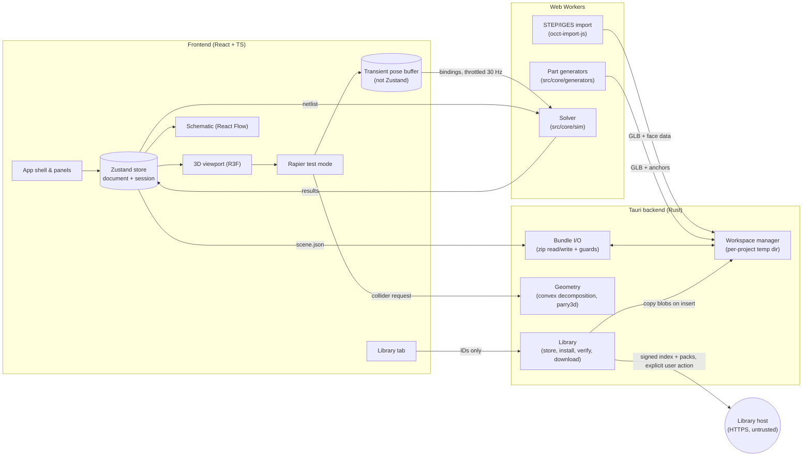

# StudioVD: Architecture & Implementation Plan

Status legend: `[x]` done and verified · `[ ]` to do · ⛔ = **stop and get user approval**.

---

## 0. Phase overview

| # | Phase | Outcome you can test |
|---|---|---|
| 1 | Setup & planning | Tauri + React-TS scaffold builds; `CLAUDE.md`, `PLAN.md` |
| 2 | UI scaffolding & state | Full app shell with resizable panels, menu bar, store, undo/redo |
| 3 | Core 3D & physics spike | Grid, lights, CAD camera; two blocks on a hinge, mouse-drag blocked by collision |
| 4 | Import pipeline | GLB/OBJ/STL/STEP/IGES parts appear in viewport + scene tree, in mm |
| 5 | Project bundle | Save/open `.stvd` round-trips exactly |
| 6 | Materials | PBR library + editor; metal, plastic, glass look right |
| 7 | Anchors | Click a face/hole/vertex to place an anchor frame; hole axes auto-detected |
| 8 | Mates & snapping | Pick two anchors and a type: parts snap together, DOF shown |
| 9 | Component library I | Local library + in-app standard-part generators (bearings, screws, gears…); drag a part in, it snaps |
| 10 | Kinematic test mode | Drag assemblies; joints + collisions hold at 200 parts; gear/belt/screw couplings |
| 11 | Schematic editor | Domain-typed nodes/ports, validated wiring, black-box sub-blocks |
| 12 | Simulation engine | Steady-state multi-domain solve with gravity loads; values on wires |
| 13 | 3D ↔ simulation bindings | Dragging a hinge changes the sim; sim lights an LED in 3D |
| 14 | Component library II | Signed online catalog; download electronics/motor/board packs as smart components |
| 15 | Hardening & release | CSP, perf pass, CI, Windows + Linux installers |

Phases 4 → 15 are my proposed order (you specified 1-3). Save/load (5) is deliberately early
so every later feature is persisted and testable with fixture projects from day one. The
library is split: the local half (9) arrives as soon as anchors and mates exist, so tests and
the 200-part benchmark use realistic parts; the online half (14) needs the schematic and
simulation (11-13) because downloaded components carry behaviour models.

---

## 1. Architecture



### 1.1 Key decisions (and why)

1. **Document / session / transient state split** (details in `CLAUDE.md` §4). Physics poses
   update at 60 Hz; pushing them through Zustand would re-render React every frame. They live
   in a mutable buffer read inside `useFrame`.
2. **Workspace directory instead of in-memory bundles.** Opening a project extracts it into
   an app-cache workspace; imports write assets there; the viewport loads them via the Tauri
   asset protocol. Save = Rust zips the workspace + `scene.json` (atomic: write temp, rename).
   Large binaries never travel through JSON IPC; crash recovery comes for free.
3. **Geometry is normalized at import into GLB** (mm, Y-up, recentred, normals present),
   content-addressed by SHA-256. Parts *reference* an asset, so the same STL imported twice is
   stored once. One loader path at runtime (GLB) regardless of source format.
4. **Design mode vs. test mode.** Design mode: physics paused, parts placed by snapping/gizmo,
   `frameloop="demand"` (idle GPU ≈ 0). Test mode: physics runs from the design pose; on exit,
   *Reset* (default) or *Apply pose* (one undoable commit).
5. **Fixed mates merge parts into one rigid body** (compound collider) instead of a Rapier
   fixed joint. Exact, cheaper, and removes joint drift from the most common constraint.
6. **Collision proxies, not render meshes.** Rapier trimesh colliders are hollow and unreliable
   between dynamic bodies, and its JS build has **no convex decomposition** (verified in
   `@dimforge/rapier3d-compat` 0.19.2). So: grounded bodies may use trimesh; dynamic bodies use
   convex hull (default) or convex decomposition computed in Rust (`parry3d`), cached in the bundle.
7. **Mated pairs don't collide by default** (`ImpulseJoint.setContactsEnabled(false)`), and
   pairs already interpenetrating when test mode starts (zero-clearance CAD fits) are filtered
   with `useFilterContactPair` (verified present in `@react-three/rapier` 2.2.0) and reported.
   Without this, a shaft modelled exactly in its bore makes the assembly explode on start.
8. **Mouse drag = force-limited spring, not teleport.** Each physics step applies an impulse
   toward the cursor target at the grab point, clamped to a max force, with CCD on. When a
   collision blocks the part, the spring just stretches; the part stays blocked. Setting
   positions directly would tunnel through other parts.
9. **Simulation = steady-state, multi-domain, effort/flow formulation** (see §3).
10. **Every Tauri call goes through `src/lib/tauri/`** so the full UI runs in a browser with
    `mockIPC` for Playwright tests.
11. **Library components are copied into the project on insert** (§4.6). A `.stvd` never
    depends on the library being installed, and removing or updating packs never breaks a file.
12. **Downloaded content is data only; behaviour is app code.** Packs reference simulation
    models, generators and schematic symbols built into the app by ID@major. No pack can
    execute code (§4.7).

### 1.2 Project bundle (`.stvd`)

A zip with a custom extension, `.stvd` (user decision). No registered format uses `.stvd`;
ST Visual Develop ("STVD") uses `.stw`/`.stp`. `.svd` was rejected because CMSIS-SVD
microcontroller register files already use it.

```
MyAssembly.stvd
├── scene.json                         master file (schema-validated, versioned)
├── geometry/<sha256>.glb              normalized geometry, one per unique asset
├── sources/<sha256>.<step|iges|...>   optional originals (re-tessellate at another quality)
├── textures/<sha256>.<png|jpg>
├── colliders/<sha256>-<params>.bin    cached convex decompositions
├── licenses/<sha256>.txt              full licence texts of library content used in the project
└── thumbnail.png
```

### 1.3 `scene.json` shape (v1 sketch, finalized as zod schemas in Phase 2/5)

Library fields are part of v1 from the start, so Phase 9 needs no schema migration.

```ts
interface SceneFile {
  format: "studiovd"; schemaVersion: 1; appVersion: string; units: { length: "mm" };
  assets:    Record<AssetId, GeometryAsset>;   // sha256, path, bbox, triCount, faces[], volume, centroid, watertight,
                                               // license? (SPDX + attribution + source@revision)
  textures:  Record<TextureId, { path: string; sha256: string }>;
  materials: Record<MaterialId, Material>;     // appearance (PBR) + physical { densityKgM3 } + builtinKey?
  parts:     Record<PartId, Part>;             // name, assetId, parentId, position, quaternion, materialId,
                                               // materialSlots?, grounded, visible,
                                               // collider: "hull"|"decomposed"|"box"|"trimesh"|"none",
                                               // massOverrideKg?, comOverrideMm?, componentRef?
  anchors:   Record<AnchorId, Anchor>;         // partId, kind: point|planar|axial, frame {origin, z, x} (part-local),
                                               // name?, interface?, source (face | vertex | manual | component)
  mates:     Record<MateId, Mate>;             // type: fixed|revolute|prismatic|spherical, anchorA, anchorB,
                                               // flip, angleOffsetRad, limits?, contactsEnabled, suppressed
  couplings: Record<CouplingId, Coupling>;     // gear ratio / rack-pinion / lead screw between two mates (Phase 10)
  schematic: { nodes: SchematicNode[]; edges: SchematicEdge[]; blockDefs: Record<BlockDefId, BlockDef> };
  bindings:  Record<BindingId, Binding>;       // 3D quantity <-> schematic port/parameter
  componentDefs: Record<ComponentDefKey, ComponentDefSnapshot>; // validated copy of each library manifest used
  components:    Record<ComponentInstanceId, ComponentInstance>; // which entities each inserted component created
  licenseTexts:  Record<Sha256, { path: string; spdx: string }>;
  simulation:{ gravity: [number, number, number]; solver: SolverSettings };
}
```

---

## 2. Geometry, assembly & physics math (reference for Phases 4, 7, 8, 9, 12, 13)

**Mass properties** of a closed, outward-oriented triangle mesh (divergence theorem); per
triangle $t$ with vertices $\mathbf p_1,\mathbf p_2,\mathbf p_3$:

$$V_t = \tfrac{1}{6}\,\mathbf p_1\cdot(\mathbf p_2\times\mathbf p_3),\qquad V=\sum_t V_t,\qquad \mathbf c=\frac{1}{V}\sum_t V_t\,\frac{\mathbf p_1+\mathbf p_2+\mathbf p_3}{4}$$

Mass $m=\rho V$ (with $V$ converted mm³ → m³, factor $10^{-9}$). Non-watertight meshes are
flagged and require a manual mass. Mixed-material parts (motors, batteries, boards) use a
datasheet mass plus optional centre-of-mass override instead, because $\rho V$ with a uniform
density is wrong for them.

**Face classification** (for anchor snapping). STEP gives B-rep face triangle ranges but no
surface type; STL/OBJ give nothing, so faces come from normal-angle region growing. For a
face, with area-weighted unit normals $\mathbf n_k$:

$$\mathbf N=\frac{1}{\sum_k A_k}\sum_k A_k\,\mathbf n_k\mathbf n_k^{\mathsf T},\qquad \lambda_1\ge\lambda_2\ge\lambda_3,\quad \lambda_1+\lambda_2+\lambda_3=1$$

Plane: $\lambda_2\approx 0$ (normal = $\mathbf e_1$). Cylinder (hole/shaft): $\lambda_3\approx 0$
and $\lambda_2$ clearly $>0$; **axis = $\mathbf e_3$** (normals are all perpendicular to it).
A full cylinder gives $(\tfrac12,\tfrac12,0)$; an arc of angle $\alpha$ gives
$\tfrac12\left(1\pm\tfrac{\sin\alpha}{\alpha}\right)$ for the first two. Axis position and
radius: least-squares (Kåsa) circle fit of the face points projected onto the plane ⟂ axis.

**Snapping.** $M_A, M_B$ = part world matrices; $F_A, F_B$ = anchor frames in part-local
coordinates; $R_{\text{flip}}$ = 180° about the anchor's local $x$ (face-to-face); $R_z(\varphi)$ =
user angle offset. Part B (and its free sub-assembly) moves to:

$$M_B = M_A\,F_A\,R_{\text{flip}}\,R_z(\varphi)\,F_B^{-1}$$

so that B's anchor lands exactly on A's: $M_B F_B = M_A F_A R_{\text{flip}} R_z(\varphi)$.
Library insertion uses the same formula for the drag preview.

**Gravity loads** (simulation only). For a revolute mate with unit axis $\hat{\mathbf a}$ through
point $\mathbf p$, carrying distal parts $i$ (mass $m_i$, centre of mass $\mathbf c_i$):

$$\tau=\hat{\mathbf a}\cdot\sum_i(\mathbf c_i-\mathbf p)\times m_i\mathbf g \qquad\text{prismatic: }\; F=\hat{\mathbf a}\cdot\sum_i m_i\mathbf g$$

**Perspective ↔ orthographic** without a visual jump: at target distance $d$ with vertical FOV
$\theta$, the visible height is $h=2d\tan(\theta/2)$; set the orthographic camera so
$(\text{top}-\text{bottom})/\text{zoom}=h$, and the reverse when switching back.

**Light between parts** (Phase 13 optical binding). An emitter anchor with on-axis luminous
intensity $I_v$ (cd) and a sensor anchor at distance $d$ (m): the illuminance at the sensor is

$$E=\frac{I_v(\alpha)\,\cos\theta}{d^{2}}\quad[\text{lx}]$$

where $\alpha$ is the angle of the ray off the emitter's optical axis ($I_v(\alpha)=0$ outside
the beam half-angle), $\theta$ the angle between the ray and the sensor normal, and $E=0$ if
a BVH raycast finds a part in between.

**Standard-part formulas** used by generators and component models (each is unit tested):
GT2 pulley pitch diameter $d_p = z\,p/\pi$ with $p = 2$ mm (20 teeth → 12.73 mm); spur gear
pitch diameter $d = m\,z$; lead screw $v = L\,\omega/(2\pi)$ with lead $L$; helical spring
rate $k = G\,d^4/(8\,D^3\,n)$ (wire diameter $d$, mean coil diameter $D$, active coils $n$).

---

## 3. Simulation model (Phase 12)

- **Steady state only in v1 (confirmed).** Nothing auto-animates, so the natural model is an
  operating point re-solved on every change (edit, parameter, or a bound 3D joint moving during
  a drag). Capacitors are open, inductors shorted. Transient (time-domain) simulation is a
  possible later phase; keep the component interface open for it (no steady-state-only
  assumptions baked into port or netlist types).
- **3D ↔ sim coupling (confirmed):** 3D → sim carries *measurements* (joint angle/position,
  mass, gravity torque, part-contact state, distance along an anchor axis, light reaching a
  sensor); sim → 3D carries *visuals only* (LED glow, tint, force arrows, a ghost of a servo's
  commanded pose). The simulation never moves parts.
- **Two port classes:**
  - *Conserved (acausal) domains*: an across ("effort") and a through ("flow") variable.
    Connected ports share effort; flows sum to zero at each net (Kirchhoff).
    Electrical $V/I$, fluid $p/Q$, mechanical translational $v/F$, rotational $\omega/\tau$.
    Mechanical ports always have a reference terminal (the housing/frame). Fluid nets carry a
    medium tag (air, water, oil) and only same-medium ports connect, so a fan can't be wired to
    a pump. Solved together by **Modified Nodal Analysis** + Newton-Raphson for non-linear
    parts (LED, diode), dense LU (fine at this scale; sparse only if benchmarks demand it).
  - *Signal (causal) domains*: **data** and **light**. Directed output → input, evaluated in
    topological order; feedback loops iterate to a fixed point or are reported. Data values are
    typed: bool, number, PWM duty (0..1), pulse width (µs, servos), ADC counts, text (LCDs).
    Light values are luminous intensity at emitters and illuminance (lx) at sensors.
- **Power is derived, not wired:** $P = e\cdot f$ per port ($VI$, $pQ$, $Fv$, $\tau\omega$).
  I'm pushing back on "power" as its own flow domain: making it independent would let the
  model violate energy conservation.
- **Cross-domain components** couple domains inside one solve, e.g. DC motor
  ($\tau=k_t I$, $V_b=k_e\omega$), hydraulic cylinder ($F=pA$), LED (electrical → light),
  photodiode (light → electrical/data), pump, solenoid.
- **State between solves:** relays (pick-up/drop-out), limit switches (movement differential)
  and Schmitt inputs have hysteresis, so each instance keeps a small solver memory in session
  state, carried from one steady-state solve to the next.
- **Position-holding actuators** (servos, steppers, geared motors) are torque-limited holds: if
  the load torque is within the holding/stall torque the axis holds and the solver reports the
  current drawn; otherwise it reports "stalled/back-driven". The commanded angle drives a 3D
  ghost only (D3).
- **Numerics:** SPICE-style junction-voltage limiting for diodes/LEDs. Fitting one datasheet
  point with ideality $n=2$ gives saturation currents from about $3\times10^{-19}$ A (red,
  2.0 V at 20 mA) down to $3\times10^{-29}$ A (blue/white, 3.2 V at 20 mA), and Newton steps
  overflow without limiting. Also tanh-smoothed Coulomb friction (undefined at $v=0$) and a
  small `gmin` on every node. A single $(V_f, I_f)$ point can't determine $n$ and series
  resistance, so LED models need a second point from the datasheet curve.
- **Gravity** enters only as mechanical sources computed from 3D mass properties (§2). The
  Rapier world stays at zero gravity.
- **Black-box sub-blocks** (PCBs, controllers): user-defined ports (name, domain, direction,
  unit) plus behaviour from a small sandboxed expression language (e.g. `out = vin > 2.5 ? 1 : 0`,
  `I_draw = 0.12`), interpreted from an AST with hard size/depth limits. No gerber/internal
  tracing. `expr-eval` is ruled out (unmaintained since 2019, known code-execution and
  prototype-pollution CVEs).
- **Unknown model IDs** (a project made with a newer StudioVD) become a solver diagnostic,
  never a crash or a refusal to open the file.

---

## 4. Component library

### 4.1 What "available for download only" means here

- **Model packs are never bundled in the installer.** 3D geometry and component data are
  downloaded on explicit user action, cached locally, and work offline afterwards.
- **Code is never downloaded.** Simulation models, schematic symbols and parametric
  generators ship inside the app; packs refer to them by ID and major version. Downloading
  code would turn the library host into a remote-code-execution channel.
- Consequence: standard mechanical parts made by **in-app generators** (screws, nuts,
  bearings, gears…) are available offline from day one. They are code plus small dimension
  tables (kilobytes), not model files. This needs your confirmation (§7 Q2).

### 4.2 Three tiers

| Tier | Content | Source | Licence of the geometry |
|---|---|---|---|
| 1. Generators (in app, Phase 9) | ISO 4762/4017/7380 screws, ISO 4032 nuts, ISO 7089 washers, set screws, deep-groove bearings (608, 625, 688, 6000-6005), LM8UU, shafts/tubes/standoffs, spur gears (module, teeth), GT2 pulleys + belt, T8 lead screw + nut, springs, 2020/2040 T-slot extrusions + brackets, pin headers/sockets, 18650/AA cells, enclosure boxes | Our own TypeScript generators; dimension tables written by us from the standards, cross-checked against cq_warehouse/bd_warehouse (Apache-2.0) | None needed (generated). Never copy GPL sources (NopSCADlib, BOLTS code, KiCad generators, FreeCAD Fasteners) |
| 2. Electronics packs (download, Phase 14) | LEDs and optos, passives, diodes, switches/buttons, connectors (barrel jack, USB, JST, terminal blocks), relays, TO-220 regulators/MOSFETs, battery holders, buzzers, LCD, Raspberry Pi Pico, ESP32 modules | KiCad `kicad-packages3D`, pinned to tag 10.0.7; Espressif KiCad library | CC-BY-SA-4.0 WITH KiCad-libraries-exception |
| 3. Boards & electromechanical (download, Phase 14) | NEMA 17, 28BYJ-48, TT/130 DC motors, micro/standard servos, fans, Arduino Nano, ESP32 DevKit, breadboard, Uno-class board | Adafruit_CAD_Parts (MIT); FreeCAD-library (CC-BY-3.0, per-file provenance audit); StudioVD-authored simplified models (CC0) where no clean source exists (e.g. Arduino Uno) | MIT / CC-BY-3.0 / CC0 |

**Excluded as sources** (terms forbid redistribution or impose copyleft on content):
McMaster-Carr, TraceParts, GrabCAD, 3D ContentCentral, NopSCADlib, BOLTS. Users can still
import such files themselves into their own projects or private library.

### 4.3 Smart component format (`component.json`)

One format for downloaded, generated and user-made components (one validator, one insertion
path). Draft TypeScript interfaces live in `docs/research/component-library/schema-drafts/`.

- **Identity:** `<namespace>/<slug>`, semver (MAJOR = a key removed or renamed, which breaks
  mates/wires/bindings), name, category, tags, family, designator prefix (`LED`, `R`, `M`),
  optional vendor/MPN.
- **Parts:** 1..64 parts with GLB refs by SHA-256 (multi-part: servo body + horn, bearing
  outer + inner ring), collider kind, material slot refs to stable built-in keys
  (`std.steel`, `std.abs`…), mass + centre-of-mass override.
- **Anchors:** part-local frames with names and interface tags (e.g. `shaft-5mm`, `M3-hole`)
  so the insert tool can suggest compatible snaps. **Internal mates** (servo horn revolute
  with limits) are created on insert; **suggested mates** to other parts are hints only.
- **Schematic block:** `SimModelId@major` + parameters with units, ranges, and a source and
  confidence for every datasheet number; ports mapped to anchors (an LED's leads, a motor's
  shaft); built-in symbol ID.
- **Bindings:** component-local (potentiometer wiper ← its own revolute angle; LED light → its
  emissive) or **external slots** the user fills in (a limit switch's actuator contact).
- **Licence:** separate grants for geometry, data and thumbnail (SPDX, creators, source URL @
  revision, modifications statement, licence text by hash, `attributionRequired`,
  `redistributable`), plus inherited licences for user components built from library parts.

### 4.4 Packs, catalog and trust

- **Pack** = `.stvdpack` zip: `pack.json` (every file with SHA-256 and size; unlisted entries
  reject the pack), `components/<ns>/<slug>/<ver>/component.json` + thumbnail,
  `geometry/<sha256>.glb`, `textures/`, `licenses/`. File-type allowlist: JSON, GLB, PNG, JPG,
  TXT. No SVG, HTML, scripts, or external/data URIs inside GLBs.
- **Download unit = category pack** ("LEDs & optos", "Passives", "Motors"…), each ≤ ~50 MB.
  KiCad models are 24-180 KB of STEP each, so a category of ~100 parts is a few MB. Few large
  files suit GitHub (1000 assets per release, rate limits) better than thousands of tiny ones.
  Installs are still recorded per component, and identical geometry is stored once in a
  content-addressed store.
- **Catalog index** (`index.json`, ≤ 16 MiB) lists every component's summary (name, tags,
  domains, licence, triangle count, pack), so search and browsing work before anything is
  downloaded; thumbnails come as one bundle per catalog publish (3 requests to browse).
- **Chain of trust:** two minisign (Ed25519) public keys compiled into the Rust binary (active +
  offline backup, separate from any updater key) → `index.json.minisig` verifies the index,
  with a trusted comment binding catalog id, sequence and schema → index gives SHA-256 + size of
  each pack → `pack.json` gives SHA-256 of each file. Transport and mirrors are untrusted.
  Rollback guard: the highest verified sequence is stored and lower ones are rejected. An
  expired cached index is refetched before installing.
- **Hosting:** GitHub Releases on a separate public repo (`bmisho/StudioVD` is private, so its
  releases can't serve anonymous downloads; §7 Q1), immutable releases; pack releases are
  created with `--latest=false` and only catalog releases are marked latest, so the stable
  URL `…/releases/latest/download/index.json` always points to the catalog. A Cloudflare R2
  mirror or a user-set mirror URL can be added later without an app release, because trust
  comes only from the signatures.

### 4.5 Local storage (Rust writes, webview reads)

`appLocalDataDir/library/` (Windows: `%LOCALAPPDATA%\com.studiovd.desktop\library`, Linux:
`~/.local/share/com.studiovd.desktop/library`). Not Roaming, and not the cache dir (OS cleaners
purge caches; on Windows the cache dir is the same folder). The webview profile also lives in
`appLocalDataDir`, so asset-protocol scopes name only `library/store`, `library/components`
and `library/previews`, never the whole folder. Layout: `catalogs/`, `store/` (content-addressed
blobs), `components/`, `staging/` (atomic installs, swept at startup), `installed.json`, `LOCK`.

### 4.6 Insertion

Drag from the Library tab uses pointer events with a DOM ghost, then a 3D ghost over the
viewport. Not HTML5 drag-and-drop, which on Windows would need Tauri's native file-drop turned
off; Phase 4 needs native file-drop for imports. Placement priority: snap to a compatible
anchor (interface tags + the §2 snap formula), else the surface under the cursor, else the
ground. Drop → Rust copies the component's blobs into the project workspace (skipping hashes
already present) → **one** store action in **one** undo entry creates the parts, anchors,
internal mates, schematic node, bindings and a `components[...]` record. Updates are offered
only after an explicit catalog refresh, applied as one undo entry and matched by key. A MAJOR
version change is offered as Replace.

### 4.7 Network, security and privacy rules

- The webview makes **no network requests**. Downloads are done in Rust with reqwest 0.13
  (rustls + OS trust store via `rustls-platform-verifier`, system proxy), never through
  `tauri-plugin-http`/`-upload`. Those plugins would pull in a second reqwest and use bundled
  roots that ignore corporate CAs. Commands take IDs, never URLs or paths.
- Network use only on explicit action (Browse, Refresh, Download, Check for updates). Opt-in
  "check weekly" is off by default. A first-use consent dialog names the hosts, and an
  "Offline mode" switch disables networking entirely.
- Corporate networks: Settings → Network offers system/manual/no proxy, an extra trusted CA
  (PEM, merged with OS roots), a custom mirror URL, a connection test with a precise diagnosis,
  and **Install from file** (a pack + `.minisig` downloaded in a browser, which handles PAC/NTLM
  proxies that reqwest can't).
- Zip handling (shared with `.stvd`): own extraction loop (never `ZipArchive::extract`, see
  RUSTSEC-2025-0168), `enclosed_name()` required, symlinks rejected, byte-counted size and
  compression-ratio caps, Windows reserved names and case collisions rejected.
- Every pack, sideloaded file and `componentDef` inside an opened `.stvd` goes through the same
  zod validation (strict objects, finite numbers, unit-length vectors, collection caps,
  `__proto__`/`constructor` keys refused). Reserved namespaces (`official`, `gen`, `builtin`,
  `studiovd`) are accepted only with a valid signature.

### 4.8 Licensing and attribution

- Official-catalog content allowlist (enforced in pack CI): CC0-1.0, CC-BY-3.0, CC-BY-4.0,
  CC-BY-SA-4.0 (± KiCad-libraries-exception), MIT, BSD-2/3-Clause, Apache-2.0. Rejected: NC,
  ND, GPL/LGPL content, vendor-portal models.
- KiCad's licence says redistributed **collections** keep CC-BY-SA-4.0 and its attribution and
  licence documents. Our packs therefore ship KiCad's `LICENSE.md` (several KiCad STEP files
  carry no licence header), credit "KiCad Libraries contributors", link the pinned source, and
  state the modifications (tessellated, recentred, Y-up). The KiCad exception means a user's
  `.stvd` design using these models does not itself become CC-BY-SA. Applying "electronic
  designs" to a mechatronic assembly is a reasonable reading, not a certainty.
- Attribution travels automatically: `licenses/` and `componentDefs` inside every `.stvd`, a
  derived **Project credits** dialog, glTF `asset.copyright` + structured `extras` on GLB
  export, a `.credits.txt` sidecar for STL export.
- Every datasheet number in a pack carries a source and confidence. Pack CI blocks "low"
  confidence values unless explicitly waived. The research for this plan could not reach most
  vendor sites, so all values must be re-checked against primary datasheets when packs are
  built.

### 4.9 Catalog scope v1 (from research; details in `docs/research/component-library/`)

- **Electrical (44 researched):** axial resistor, potentiometer, 5 mm LEDs (R/G/B/W),
  1N4007, 1N5819, tactile and slide switches, limit microswitch, AA/9 V/18650 cells, USB and
  bench supplies, LM7805, LM2596 buck module, IRLZ44N, 2N2222A, relay module, buzzer, LDR,
  BPW34, 130 DC motor, SG90/MG996R servos, NEMA 17, 28BYJ-48 + ULN2003, 40/80 mm fans, push-pull
  solenoid, mini pump, solenoid valve, Arduino Uno/Nano, ESP32 DevKitC, Raspberry Pi Pico,
  HC-SR04, 16×2 LCD, headers, screw terminals, barrel jack.
  Still missing for real projects: H-bridge and stepper drivers (TB6612/L298N, A4988/TMC2208
  class), fuse, capacitor/inductor (open/short in steady state).
- **Mechanical / fluid / optical (27 researched):** the Tier 1 generator families above, plus
  butt hinge, ISO 6432 mini pneumatic cylinders, push-in fittings + PU tubing, ball and check
  valves, laser diode module, lens, mirror.
- Cloned hobby parts (SG90, 28BYJ-48, HC-SR04, LM2596 modules…) vary by vendor: each catalog
  item states exactly which part it represents and every parameter can be overridden per
  instance. Pinout variants (e.g. PN2222A E-B-C vs P2N2222A C-B-E) are selectable.

---

## 5. Risks & mitigations

| Risk | Mitigation |
|---|---|
| Impulse joints are slightly soft and drift under strong drag forces | Force-clamped drag spring, more solver iterations, fixed mates merged into rigid bodies; headless drift tests |
| Thin parts tunnel when dragged fast | CCD on dynamic bodies + velocity clamp |
| Zero-clearance CAD fits interpenetrate at start | Contacts off for mated pairs; start-of-test interference scan → filtered + reported |
| Rapier JS joints and arbitrary part orientations: a hinge may "jump" if local frames are wrong | Phase 3 headless test creates a hinge between differently-rotated bodies and asserts zero initial correction (`JointData.frame1/frame2` exist; behaviour to be verified) |
| Rapier has no gear, belt, rack-pinion or screw coupling between joints | Phase 10 spike: velocity-level coupling impulses in `useBeforePhysicsStep`; fallback = coupling only in the schematic + readouts in test mode |
| Belts, tubes and springs change shape, but parts are rigid | "Derived connector geometry": regenerated from its end anchors, visual only, no collider |
| WebView differences: Windows uses WebView2 (Chromium, strong WebGL); Linux uses WebKitGTK (the weakest WebGL host, some GPU/driver combos need `WEBKIT_DISABLE_DMABUF_RENDERER=1`) | WebGL2 only; E2E runs on Playwright Chromium (≈ WebView2) and WebKit (≈ WebKitGTK); Phase 3 gate includes a real run on Windows and Linux |
| Generator output differs in the last bits between V8 (Windows) and JavaScriptCore (Linux), since `Math.sin` etc. are implementation-approximated | Generated GLBs are stored in the project and never silently regenerated; golden tests compare within tolerance, not bytes |
| `occt-import-js` is 7.6 MB WASM, LGPL-2.1 | Lazy-load in a worker only when importing STEP/IGES; ship it unmodified as a separate file + licence notice |
| Default drei/three assets fetch from CDNs (HDRI presets, DRACO decoder) | Bundle locally; CSP blocks external origins |
| Triangle count, not part count, is what kills frame rate | Tessellation quality presets at import; warn above the ~2-3 M triangle budget |
| Multi-domain simulation scope creep | Steady state only, small component library v1, solver tested against textbook results |
| Corporate networks block GitHub, use PAC/NTLM proxies or TLS inspection | OS trust store + extra CA, manual proxy, mirror URL, Install-from-file, precise connection test |
| Library signing key lost (no more updates accepted) or compromised (malicious catalogs accepted until an app update) | Offline primary key + embedded backup key, documented rotation; packs are data only and parsers are hardened, which limits the damage |
| Licence interpretation (KiCad exception scope; CC-BY-SA reach into exported GLBs) | Per-asset licence metadata everywhere, automatic attribution, allowlist in CI; flagged for legal review before public release |
| Datasheet values wrong or vendor clones differ | Source + confidence per value, CI gate on low confidence, per-instance overrides |
| GitHub throttling or policy change on release downloads | Hosting is behind a mirror list; adding R2 or another host is a config change, not an app release |

---

## 6. Decisions log

| # | Question | Decision (2026-10-09) |
|---|---|---|
| D1 | Target OSes | **Windows + Linux.** macOS not targeted (code stays portable, but untested) |
| D2 | Simulation fidelity | **Steady state** for v1 |
| D3 | 3D ↔ sim semantics | **Measurements in, visuals out**; sim never moves parts |
| D4 | Default mouse mapping | **SolidWorks-style** default (assumed from "yes" to the first option); other presets selectable |
| D5 | Project extension / app ID | **`.stvd`**, `com.studiovd.desktop` |
| D6 | Common-component library | **Required**, download-only model packs (§4); design pending approval of §7 |

## 7. Open questions (answers change the plan)

1. **Library hosting repo.** Packs need a *public* place to download from. OK to create a
   public repo, e.g. `bmisho/studiovd-library` (pack sources, build CI, releases)? I won't
   create it without your go-ahead. It's needed in Phase 14, not before.
2. **In-app generators.** Confirm that standard mechanical parts generated by app code (§4.1)
   are fine, i.e. "download only" applies to model packs, not to code.
3. **App licence.** The repo has no LICENSE yet. Not blocking until a public release, but it
   decides how third-party notices are shipped (GPL code is excluded either way).

---

## Phase 1: Project setup & architecture planning

- [x] 1.1 Scaffold Tauri 2 + React 19 + TypeScript + Vite via `create-tauri-app` (react-ts)
- [x] 1.2 Set product name, identifier (`com.studiovd.desktop`; the generated `.app` suffix
  conflicts with macOS bundles), window size 1440×900, min 1024×680
- [x] 1.3 Verify: `npm run build` passes; `cargo check` passes (Linux system deps installed)
- [x] 1.4 Research pinned versions & capabilities (R3F 9 needs React `<19.4`; rapier filters,
  joint frames, no JS convex decomposition; occt-import-js B-rep face output)
- [x] 1.5 `CLAUDE.md` (rules, stack, palette with computed contrast ratios, layout)
- [x] 1.6 `PLAN.md` (this file)
- [x] 1.7 Answers to open questions recorded (§6 D1-D5)
- [x] 1.8 Component library research + design (§4, Phases 9 and 14; raw research in
  `docs/research/component-library/`)
- [ ] ⛔ 1.9 **User approval of the revised plan + answers to §7**

## Phase 2: UI scaffolding & state

Tooling
- [ ] 2.1 Path alias `@/` → `src/`; scripts `typecheck`, `lint`, `test`, `test:e2e`
- [ ] 2.2 ESLint (typescript-eslint, react-hooks) + Prettier
- [ ] 2.3 Vitest + React Testing Library + jsdom; Playwright with Tauri `mockIPC`
- [ ] 2.4 GitHub Actions CI: lint, typecheck, unit tests, `cargo check`/`clippy`

Design system
- [ ] 2.5 Tailwind 4 via `@tailwindcss/vite`; theme tokens from `CLAUDE.md` §7
- [ ] 2.6 shadcn/ui init + components: button, menubar, dropdown-menu, context-menu, tooltip,
  tabs, input, label, slider, select, switch, toggle-group, scroll-area, resizable, dialog,
  separator, collapsible, sonner
- [ ] 2.7 Bundle Inter locally (`@fontsource-variable/inter`); compact density defaults

State
- [ ] 2.8 Branded ID types (incl. `ComponentInstanceId`, `ComponentDefKey`, `CouplingId`) +
  entity types in `src/core/schema` (zod, v1 draft)
- [ ] 2.9 Zustand store: `document` slices (project, scene, assembly, schematic, bindings,
  components) with `immer` + `zundo`; `session` slices (selection, tool, view, test mode,
  sim results, library jobs)
- [ ] 2.10 Undo/redo with gesture batching (pause/resume API); unit tests
- [ ] 2.11 `src/lib/tauri/` wrapper layer (stubbed commands: new/open/save/import)

Shell
- [ ] 2.12 Menu bar: File (New, Open, Save, Save As, Import…, Export ▸ GLB/STL, Exit), Edit
  (Undo, Redo, Delete), View (Perspective/Ortho, Split horizontal/vertical, toggle panels), Help
- [ ] 2.13 Toolbar: Select · Place Anchor · Mate · Test mode toggle · projection toggle
- [ ] 2.14 Left sidebar tabs: Scene graph (tree from store: parts, mates) · Library (placeholder
  with sources: Installed, My components, Generators, Online catalog, Schematic primitives)
- [ ] 2.15 Right sidebar: Properties for current selection (placeholder inspectors)
- [ ] 2.16 Centre: resizable split 3D | Schematic (placeholders), orientation toggle, maximize a pane
- [ ] 2.17 Status bar: selection count, units, mode, sim status
- [ ] 2.18 Keyboard shortcut registry (Ctrl+S, Ctrl+Z, Ctrl+Shift+Z / Ctrl+Y, Delete, F, Esc)
- [ ] 2.19 Per-panel error boundaries (a crashed schematic must not take down the viewport)

Exit criteria
- [ ] 2.20 Unit tests (store, undo batching), component tests (shell renders, menus open),
  Playwright smoke (layout visible, panels resize), `npm run build`, `cargo check`
- [ ] 2.21 Screenshot of the shell for review
- [ ] ⛔ 2.22 **User approval**

## Phase 3: Core 3D & physics

Viewport
- [ ] 3.1 R3F `<Canvas>`: WebGL2, `frameloop="demand"`, DPR [1, 2], Khronos Neutral tone
  mapping, sRGB output, gradient background
- [ ] 3.2 Infinite grid (mm: 10 mm minor / 100 mm major, distance fade) + axis triad + view cube
- [ ] 3.3 Lighting: hemisphere + key/fill directional + local `RoomEnvironment` PMREM (no network)
- [ ] 3.4 `CameraControls`: SolidWorks-style default (middle-drag orbit, Ctrl+middle pan, wheel
  zoom; left click reserved for pick), presets for Fusion 360 / Onshape / Blender in settings,
  zoom-to-cursor, fit-all (F/Home)
- [ ] 3.5 Perspective ↔ orthographic toggle preserving framing (§2 formula, unit tested)
- [ ] 3.6 Hover + click selection (synced to store; highlight in `highlight-3d`)

Physics spike
- [ ] 3.7 `<Physics>`: gravity 0, fixed 60 Hz step, `lengthUnit` tuned for mm, paused outside test mode
- [ ] 3.8 Two blocks: base (fixed) + leaf (dynamic) joined by a revolute joint on the base's top
  edge with a 1 mm gap; contacts **enabled** for this pair so the leaf swinging down hits the
  base's side face. Optional third obstacle block.
- [ ] 3.9 Drag controller: grab point from raycast, camera-facing drag plane, force-clamped spring
  impulse in `useBeforePhysicsStep`, high damping so parts stop on release, CCD + velocity clamp
- [ ] 3.10 Test-mode enter/exit with *Reset to design pose*

Exit criteria
- [ ] 3.11 Headless Vitest (Rapier in Node): (a) pushing the leaf into the base never passes the
  geometric stop angle; (b) hinge anchor separation stays < 0.01 mm; (c) a hinge between
  differently-rotated bodies produces no initial jump; (d) released part comes to rest
- [ ] 3.12 Unit tests: drag spring math, ortho/perspective conversion
- [ ] 3.13 Playwright: canvas renders (headless WebGL), screenshot
- [ ] 3.14 Manual check of `npm run tauri dev` on Windows and Linux
- [ ] ⛔ 3.15 **User approval**

## Phase 4: Import pipeline & geometry assets

- [ ] 4.1 Rust workspace manager: create/open/clean per-project workspace in app cache dir;
  asset-protocol scope; raw-binary `write_asset` command; Rust unit tests
- [ ] 4.2 Import dialog: file picker (GLB/GLTF, OBJ+MTL, STL, STEP/STP, IGES/IGS), unit
  (mm/cm/m/in), up axis (Y/Z), STEP tessellation quality (coarse/normal/fine), split mode
  (one part per mesh/node)
- [ ] 4.3 GLB/GLTF loader with locally bundled DRACO + meshopt decoders; OBJ/MTL; STL
- [ ] 4.4 STEP/IGES worker (occt-import-js, lazy WASM): progress, cancel, hierarchy → parts,
  B-rep face ranges and per-face colours retained
- [ ] 4.5 Normalize: units → mm, up-axis, recentre to bbox centre (offset into part transform),
  normals, export GLB, SHA-256 dedup, write to workspace. Pure `src/core` functions, runnable in
  Node, because the Phase 14 pack builder reuses them
- [ ] 4.6 Per-asset analysis: BVH (three-mesh-bvh), face segmentation (B-rep ranges or
  normal-angle region growing), face classification (§2), volume/centroid/watertight (§2)
- [ ] 4.7 Scene graph: imported hierarchy, rename, show/hide, isolate, delete, group (a group is
  its own entity; component instances map onto it); grounded flag (first part grounded by default)
- [ ] 4.8 Transform gizmo (design mode) for free placement, single undo entry per drag
- [ ] 4.9 Export: assembly or selection to GLB/STL (current pose)
- [ ] 4.10 Tests: fixtures (`cube.step`, `bracket.stl`, `sample.glb`); unit cube volume = 1 mm³,
  unit conversions, recentring, synthetic cylinder → axis within 0.1°; import E2E with mocked IPC;
  triangle-budget warning
- [ ] ⛔ 4.11 **User approval**

## Phase 5: Project bundle save/load

- [ ] 5.1 Final `scene.json` v1 zod schema (incl. library fields from §1.3) + migration
  framework (`vN → vN+1` functions) + tests
- [ ] 5.2 Rust `bundle`: zip write (deflate JSON/GLB, store PNG/JPG), atomic temp+rename,
  extract into workspace. The zip guard is a generic module (limits and allowlist as
  parameters, symlink rejection, counted bytes, reserved names) reused by library packs
- [ ] 5.3 Commands: New, Open, Save, Save As, Close; dirty tracking; "unsaved changes" prompt on
  window close; recent files (app config dir)
- [ ] 5.4 File association for `.stvd` + open-on-launch (single-instance forwarding)
- [ ] 5.5 Autosave to workspace + crash-recovery prompt on next launch; thumbnail capture
- [ ] 5.6 Save-time GC: drop assets, licence texts and `componentDefs` nothing references
- [ ] 5.7 Tests: Rust round-trip, zip-slip and symlink rejection, truncated zip, ratio bomb;
  TS schema round-trip; E2E import → save → reopen → deep-equal document
- [ ] ⛔ 5.8 **User approval**

## Phase 6: Materials & appearance

- [ ] 6.1 Material model: appearance (`MeshPhysicalMaterial`: colour, metalness, roughness,
  clearcoat, transmission, IOR, thickness, opacity, emissive, texture maps) + physical (density);
  per-part material slots keyed by glTF material name (multi-colour STEP/GLB parts)
- [ ] 6.2 Built-in library with stable keys and densities (kg/m³): ABS 1040, PLA 1240,
  PC clear 1200, Acrylic 1180, POM 1410, Polyurethane 1200, Glass 2500, Aluminium 6061/6063 2700,
  Steel 7850, Stainless 8000, Brass 8500, Copper 8960, Rubber 1100, FR-4 1850
- [ ] 6.3 Material editor (right sidebar): preset grid with rendered sphere thumbnails, sliders,
  colour picker, texture slots (images stored in `textures/`)
- [ ] 6.4 Assign to selection; drag a preset onto a part in the viewport
- [ ] 6.5 Transparency: sorted transparent pass, no depth write; `transmission` only for glass presets
- [ ] 6.6 Display modes: shaded, shaded + feature edges (~30° threshold), wireframe, X-ray
- [ ] 6.7 Tests: material → three params mapping, schema round-trip, visual screenshot
- [ ] ⛔ 6.8 **User approval**

## Phase 7: Anchor system

- [ ] 7.1 Anchor model: part-local frame (origin, z, x), kind (point/planar/axial), optional
  name and interface tag (e.g. `shaft-8mm`), source reference (face id, vertex, manual, component)
- [ ] 7.2 "Place Anchor" tool: live preview of the candidate frame under the cursor before click
- [ ] 7.3 Snap modes: face (hit point or face centre), axis (cylinder from face classification),
  vertex, edge midpoint, circle centre (hole edge); pixel-based snap thresholds
- [ ] 7.4 Anchor glyphs (screen-constant size triads), list in properties, rename, numeric offset
  edit, delete; anchors follow their part
- [ ] 7.5 Tests: classification and circle-fit on synthetic meshes (plane, full/partial cylinder,
  sphere); snap selection logic; E2E place anchor on fixture STEP hole → axial anchor
- [ ] ⛔ 7.6 **User approval**

## Phase 8: Mates & snapping

- [ ] 8.1 Mate model: fixed / revolute / prismatic / spherical; flip; angle offset (rad);
  limits; `contactsEnabled`; suppressed
- [ ] 8.2 Mate tool: pick anchor A → anchor B → type → live preview → apply (single undo entry);
  suggests compatible anchors by interface tag
- [ ] 8.3 Snap math (§2); moves the side not connected to ground; error if both sides grounded
- [ ] 8.4 Assembly graph: union-find rigid groups (fixed mates), DOF per group, closed-loop
  detection (allowed, warned), conflict detection
- [ ] 8.5 Mates folder in scene graph; edit/suppress/delete; DOF badge; highlight mated anchors
- [ ] 8.6 Tests: anchors coincide after snap (< 1e-9 mm), axes aligned/opposed, group/DOF
  computation, conflict cases
- [ ] ⛔ 8.7 **User approval**

## Phase 9: Component library I (local library + generators)

- [ ] 9.1 zod schemas for `component.json`, `pack.json` and the catalog index (§4.3-4.4), with
  every validation rule from §4.7; valid/invalid fixture suite
- [ ] 9.2 Rust `library` module (local part): store layout (§4.5), content-addressed blobs,
  staging + atomic install, `installed.json` (rebuildable from disk), single-writer lock, GC;
  Install-from-file for `.stvdpack` (unsigned packs show an "Unverified" badge after confirmation)
- [ ] 9.3 Generators v1 in a Web Worker (pure TS in `src/core/generators/<id>/v<major>.ts`, zod
  params, analytic anchors with interface tags, mass, default material): deep-groove bearing
  (outer + inner ring + revolute), ISO 4762 screw, ISO 4032 nut, ISO 7089 washer, set screw,
  shaft/tube/standoff, spur gear (involute; profile shift for z < 17), GT2 pulley, T8 lead
  screw + nut, compression/extension spring, 2020/2040 extrusion + corner bracket, pin
  header/socket, 18650/AA cell, enclosure box, primitives. Dimension tables are ours, written
  from the standards and cross-checked against bd_warehouse (Apache-2.0)
- [ ] 9.4 Library tab: sources (Installed, My components, Generators; Online catalog disabled
  until Phase 14; Schematic primitives from Phase 11), search in a worker, virtualized cards,
  badges (Official / User / Unverified / Needs newer StudioVD), "Licence & source" popover
- [ ] 9.5 Insertion (§4.6): pointer-event drag, transient ghost, snap-to-compatible-anchor,
  surface and ground placement, R rotates / Alt skips snapping / Esc cancels, Rust copies the
  blobs, one undo entry, designators (`M2`, `LED3`), component selected as a group (double-click
  enters it), Unlink, Edit parameters (generators; keeps keys so external mates survive)
- [ ] 9.6 Derived connector geometry (belt between pulleys, tube between fittings, spring
  between anchors): regenerated from its end anchors, visual only, no collider
- [ ] 9.7 Save as component → user library (same format and validator; licences of library parts
  inside are inherited automatically); Export pack; harvest a component from an opened `.stvd`
- [ ] 9.8 Credits: Project credits dialog, `licenses/` in the bundle, GLB export
  `asset.copyright` + `extras`, STL `.credits.txt` sidecar
- [ ] 9.9 Tests: generator golden tests (geometry within tolerance, anchor keys stable, analytic
  mass vs mesh mass), schema fixtures, Rust guards (zip-slip, symlink, ratio bomb, unlisted
  entry, reserved name), E2E: insert → undo → redo → save → reopen with an **empty** library dir
- [ ] ⛔ 9.10 **User approval**

## Phase 10: Kinematic test mode at assembly scale

- [ ] 10.1 Build Rapier world from the assembly graph: rigid groups → bodies (compound colliders),
  grounded → fixed, mates → joints with per-body local frames + limits
- [ ] 10.2 Collider strategy per part: trimesh (grounded only) / hull (default) / decomposed / box /
  none; Rust `parry3d` convex decomposition command, async with progress, cached in `colliders/`
- [ ] 10.3 Start-of-test interference scan: penetrating pairs filtered via `useFilterContactPair`
  and listed in an Interference panel
- [ ] 10.4 Drag controller generalized to imported parts and rigid groups; live joint readouts
- [ ] 10.5 Coupling spike: gear ratio (revolute ↔ revolute), rack-pinion and lead screw
  (revolute ↔ prismatic) as velocity-level coupling impulses before each step; belt drives as
  gear couplings. Fallback if unstable: schematic-only coupling + readouts
- [ ] 10.6 Derived connector geometry follows its anchors live during test mode
- [ ] 10.7 Exit: Reset (default) / Apply pose (one undoable commit)
- [ ] 10.8 Publish live joint coordinates to the transient pose buffer (for Phase 13 bindings)
- [ ] 10.9 Tests: slider limits respected, 3-hinge chain stable, shaft-in-bore with decomposition
  has no false interference, gear pair keeps its ratio within 1 %, 200-part benchmark built from
  generator parts (physics step < 4 ms target), dev perf overlay
- [ ] ⛔ 10.10 **User approval**

## Phase 11: Schematic editor

- [ ] 11.1 React Flow canvas in the schematic pane: store-controlled, minimap, controls, dot grid,
  snap-to-grid, node-drag = one undo entry
- [ ] 11.2 Port model: domain, direction (in/out for signal, terminal for conserved), unit;
  typed data payloads (bool, number, PWM duty, pulse width, ADC counts, text); fluid medium tag;
  mechanical ports with a reference terminal
- [ ] 11.3 Node library v1 as a registry of `SimModelId@major` + built-in symbols (library packs
  reference these IDs):
  - Electrical: source (battery/PSU), ground, resistor, capacitor (open), inductor (short),
    switch, potentiometer, LED, diode, fuse, relay (coil + contacts), voltmeter/ammeter probes
  - Electromechanical: DC motor, servo, stepper, solenoid/linear actuator, pump, fan
  - Drivers: H-bridge (TB6612/L298N class), stepper driver (A4988 class), transistor/MOSFET switch
  - Mechanical: mechanical ground, gear/ratio, lead screw, spring, damping/friction, load
    (gravity from 3D)
  - Fluid: pressure source, restriction, valve, check valve, cylinder
  - Light: emitter, sensor, attenuator (lens/mirror)
  - Data: constant, comparator, logic gates, display/probe; MCU black boxes (Uno, Nano, ESP32, Pico)
- [ ] 11.4 Connection validation (`isValidConnection`): same domain (and fluid medium) only,
  signal out → in, one driver per input; domain colours + line patterns (`CLAUDE.md` §7)
- [ ] 11.5 Black-box block editor: ports + sandboxed expression behaviour (AST interpreter; limits:
  ≤ 2 KiB per expression, ≤ 512 AST nodes, depth ≤ 32; allowlisted pure functions only);
  reusable block definitions
- [ ] 11.6 Part ↔ node association stored as a `ComponentInstance`; cross-selection
  3D ⇄ schematic ⇄ tree
- [ ] 11.7 Library components with a schematic block create their node on insert
- [ ] 11.8 Export schematic as SVG/PNG
- [ ] 11.9 Tests: validation rules, expression parser (incl. rejection of unsafe input,
  `__proto__`, deep nesting), store, E2E create/connect/delete nodes
- [ ] ⛔ 11.10 **User approval**

## Phase 12: Simulation engine

- [ ] 12.1 Component interface: `stamp()` for conserved ports, `evaluate()` for signal ports,
  optional per-instance state (hysteresis memory); unknown model IDs → diagnostic
- [ ] 12.2 Netlist compiler: union-find nets per domain, ground references; diagnostics (floating
  net, missing ground, shorted ideal sources, medium mismatch) mapped back to nodes
- [ ] 12.3 MNA assembly + dense LU with partial pivoting; Newton-Raphson with junction-voltage
  limiting, `gmin`, tanh-smoothed friction
- [ ] 12.4 Signal propagation: topological order, cycle detection, fixed-point iteration
- [ ] 12.5 Coupled outer loop (conserved ⇄ signal) with convergence limit; hysteresis state
  carried between solves
- [ ] 12.6 Gravity sources from 3D mass properties (§2) with mass/COM overrides: part weight,
  distal torque per revolute, axial force per prismatic; configurable $\mathbf g$ (default
  9.81 m/s² along −Y)
- [ ] 12.7 Position-holding actuators (servo, stepper): hold within torque limit, else
  "stalled/back-driven" diagnostic
- [ ] 12.8 Solver in a Web Worker; debounced on edits, throttled (30 Hz) during drags
- [ ] 12.9 Results UI: values on ports/wires, flow-proportional edge animation, rating warnings,
  power totals, results table
- [ ] 12.10 Tests against known answers: voltage divider, series/parallel, KCL residual < 1e-9
  per net, energy balance, LED operating point, motor stall ($I=V/R$) and no-load
  ($\omega=V/k_e$), cylinder $F=pA$, horizontal lever $\tau=mgL$, relay hysteresis, servo
  stall, all diagnostics
- [ ] ⛔ 12.11 **User approval**

## Phase 13: 3D ↔ simulation bindings

- [ ] 13.1 Binding model: sources (mate angle/position, part/sub-assembly mass, gravity torque,
  contact state between two parts, anchor distance, raycast distance along an anchor axis for
  ultrasonic sensors, illuminance between emitter and sensor anchors per §2 with occlusion) →
  node parameters/inputs; sinks (node outputs) → 3D visuals (emissive colour/intensity, tint,
  force arrows, labels, commanded-pose ghost)
- [ ] 13.2 Component-local bindings resolve on insert; external slots prompt the user
- [ ] 13.3 Binding editor UI (from a mate/part or from a port)
- [ ] 13.4 Live loop: drag → pose buffer → sampler → solver worker → session results → 3D
  visual update via subscriptions (no React re-render per frame)
- [ ] 13.5 Example projects: hinge-driven potentiometer dims an LED; limit switch (contact) cuts
  a motor; lever holding torque sets motor current; LED → LDR light path blocked by a dragged part
- [ ] 13.6 Tests: sampler, illuminance formula, end-to-end examples in E2E
- [ ] ⛔ 13.7 **User approval**

## Phase 14: Component library II (online catalog & content packs)

- [ ] 14.1 Public hosting repo (§7 Q1) with immutable releases; pack releases `--latest=false`,
  catalog releases marked latest; post-publish smoke test of `latest/download/index.json`
- [ ] 14.2 Signing: two minisign keypairs (active + offline backup), separate from any updater
  key; trusted comment binds catalog id, sequence and schema; rotation procedure documented
- [ ] 14.3 Rust downloader: reqwest 0.13 (rustls, platform verifier, system proxy), minisign
  verification before parsing (16 MiB cap), rollback guard, expiry refetch, Range resume with
  `If-Range`, streaming SHA-256, cancellation, 2 concurrent downloads, `Retry-After` backoff,
  disk-space check, progress over `tauri::ipc::Channel` (throttled)
- [ ] 14.4 Settings → Network: offline switch, first-use consent, proxy mode, extra CA, mirror URL,
  connection test; no startup checks unless opted in
- [ ] 14.5 Online catalog in the Library tab: search from the cached index, thumbnails bundle,
  per-pack install/remove/update, "remove old versions", revocation warnings, disk usage
- [ ] 14.6 Component updates in projects: badge on same-MAJOR updates, Update = one undo entry
  matched by keys, MAJOR = Replace
- [ ] 14.7 Content pipeline (in the hosting repo's CI): pinned sources (KiCad tag 10.0.7, pinned
  Adafruit/FreeCAD commits), STEP → GLB with occt-import-js + this app's `src/core`
  normalization in Node, `@gltf-transform/core` writer, Khronos glTF validator, KiCad footprint
  pads → electrical port anchors, licence allowlist gate, name validation (Windows reserved names,
  case collisions, path length), datasheet values with source + confidence, thumbnails via
  headless Chromium
- [ ] 14.8 First catalog (§4.9): Tier 2 electronics packs + Tier 3 boards/electromechanical
  packs, each with schematic blocks from the Phase 11 registry
- [ ] 14.9 Tests: cargo tests against a mock HTTP server (200/206/416/429, redirects, truncated
  body, wrong hash, cancel mid-stream), signature tests (bad signature, rollback, mix-and-match,
  expired index), E2E with mocked IPC and test keys
- [ ] ⛔ 14.10 **User approval**

## Phase 15: Hardening & release

- [ ] 15.1 Strict CSP: no external origins at all; `script-src 'self' 'wasm-unsafe-eval'`, workers,
  IPC and asset protocol only (both `asset:` and `http://asset.localhost` forms)
- [ ] 15.2 Capability audit (least privilege): app commands restricted via the build-time app
  manifest, library commands for the main window only, narrow asset-protocol scopes
- [ ] 15.3 Performance pass on a 200-part reference assembly (load time, orbit fps, test-mode fps)
- [ ] 15.4 Undo/redo coverage audit, context menus, shortcut help overlay
- [ ] 15.5 Logging (`tauri-plugin-log`), crash reporting to local log file
- [ ] 15.6 Installers: Windows (NSIS + MSI, WebView2 bootstrapper) and Linux (AppImage + .deb),
  icons, `.stvd` file association, code-signing notes, optional updater (own key)
- [ ] 15.7 CI build matrix (`tauri build` per OS) + Playwright in CI; `cargo-deny`/`cargo-audit`
- [ ] 15.8 Docs: user guide, `scene.json` and component format specs, third-party notices
  (occt-import-js LGPL, generator data attributions)
- [ ] ⛔ 15.9 **User approval / release**
