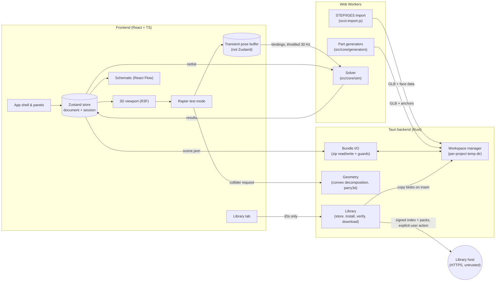

# StudioVD: Architecture & Implementation Plan

Status legend: `[x]` done and verified · `[ ]` to do · ⛔ = **stop and get user approval**.

---

## 0. Phase overview

| # | Phase | Outcome you can test |
|---|---|---|
| 1 | Setup & planning | Tauri + React-TS scaffold builds; `CLAUDE.md`, `PLAN.md` |
| 2 | UI scaffolding & state | Full app shell with resizable panels, menu bar, store, undo/redo |
| 3 | Core 3D & physics spike | Grid, lights, CAD camera; two blocks on a hinge, mouse-drag blocked by collision |
| 4 | Import pipeline | GLB/OBJ/STL/STEP/IGES parts appear in viewport + scene tree, in mm |
| 5 | Project bundle | Save/open `.stvd` round-trips exactly |
| 6 | Materials | PBR library + editor; metal, plastic, glass look right |
| 7 | Anchors | Click a face/hole/vertex to place an anchor frame; hole axes auto-detected |
| 8 | Mates & snapping | Pick two anchors and a type: parts snap together, DOF shown |
| 9 | Component library I | Local library + in-app standard-part generators (bearings, screws, gears…); drag a part in, it snaps |
| 10 | Kinematic test mode | Drag assemblies; joints + collisions hold at 200 parts; gear/belt/screw couplings |
| 11 | Schematic editor | Domain-typed nodes/ports, validated wiring, black-box sub-blocks |
| 12 | Simulation engine | Steady-state multi-domain solve with gravity loads; values on wires |
| 13 | 3D ↔ simulation bindings | Dragging a hinge changes the sim; sim lights an LED in 3D |
| 14 | Component library II | Signed online catalog; download electronics/motor/board packs as smart components |
| 15 | Hardening & release | CSP, perf pass, CI, Windows + Linux installers |

Phases 4 → 15 are my proposed order (you specified 1-3). Save/load (5) is deliberately early
so every later feature is persisted and testable with fixture projects from day one. The
library is split: the local half (9) arrives as soon as anchors and mates exist, so tests and
the 200-part benchmark use realistic parts; the online half (14) needs the schematic and
simulation (11-13) because downloaded components carry behaviour models.

---

## 1. Architecture



### 1.1 Key decisions (and why)

1. **Document / session / transient state split** (details in `CLAUDE.md` §4). Physics poses
   update at 60 Hz; pushing them through Zustand would re-render React every frame. They live
   in a mutable buffer read inside `useFrame`.
2. **Workspace directory instead of in-memory bundles.** Opening a project extracts it into
   an app-cache workspace; imports write assets there; the viewport loads them through our
   own `stvd` URI scheme, which serves `<sha256>.glb` from the workspace and nothing else
   (Tauri's asset protocol stays off: Tauri widens its scope for every file or folder dropped
   on the window). Save = Rust zips the workspace + `scene.json` (atomic: write temp, rename).
   Large binaries never travel through JSON IPC; crash recovery comes for free.
3. **Geometry is normalized at import into GLB** (mm, Y-up, recentred, normals present),
   content-addressed by SHA-256. Parts *reference* an asset, so the same STL imported twice is
   stored once. One loader path at runtime (GLB) regardless of source format.
4. **Design mode vs. test mode.** Design mode: physics paused, parts placed by snapping/gizmo,
   `frameloop="demand"` (idle GPU ≈ 0). Test mode: physics runs from the design pose; on exit,
   *Reset* (default) or *Apply pose* (one undoable commit).
5. **Fixed mates merge parts into one rigid body** (compound collider) instead of a Rapier
   fixed joint. Exact, cheaper, and removes joint drift from the most common constraint.
6. **Collision proxies, not render meshes.** Rapier trimesh colliders are hollow and unreliable
   between dynamic bodies, and its JS build has **no convex decomposition** (verified in
   `@dimforge/rapier3d-compat` 0.19.2). So: grounded bodies may use trimesh; dynamic bodies use
   convex hull (default) or convex decomposition computed in Rust (`parry3d`), cached in the bundle.
7. **Mated pairs don't collide by default** (joint `setContactsEnabled(false)`), and
   pairs already interpenetrating when test mode starts (zero-clearance CAD fits) are filtered
   with `useFilterContactPair` (verified present in `@react-three/rapier` 2.2.0) and reported.
   Without this, a shaft modelled exactly in its bore makes the assembly explode on start.
8. **Mouse drag = force-limited spring, not teleport.** Before each physics step a
   speed-limited, critically damped spring force pulls the grab point toward the cursor
   target (§2). When a collision blocks the part, the spring just stretches; the part stays
   blocked. Setting positions directly would tunnel through other parts. Contacts are found
   ahead of time (5 mm predictive contacts, speed limit 600 mm/s at 120 Hz steps), which
   verified better than Rapier's CCD for a rotating part pushed into a stop.
9. **Simulation = steady-state, multi-domain, effort/flow formulation** (see §3).
10. **Every Tauri call goes through `src/lib/tauri/`** so the full UI runs in a browser with
    `mockIPC` for Playwright tests.
11. **Library components are copied into the project on insert** (§4.6). A `.stvd` never
    depends on the library being installed, and removing or updating packs never breaks a file.
12. **Downloaded content is data only; behaviour is app code.** Packs reference simulation
    models, generators and schematic symbols built into the app by ID@major. No pack can
    execute code (§4.7).
13. **Joints: multibody for the tree, impulse only for loops; bodies start unrotated.**
    Verified in the Phase 3 spike (rapier3d-compat 0.19.2): reduced-coordinate multibody
    joints keep a hinge exact (separation about 1e-5 mm) where impulse joints opened by
    0.05-0.7 mm under a drag load. A multibody must be a tree, so a joint that closes a loop
    (four-bar linkage) stays an impulse joint. `JointData.revolute` uses ONE local axis for
    both bodies and its `frame1`/`frame2` have no effect, so every body starts with an identity
    rotation and the part's rotation goes on its collider (otherwise a hinge between
    differently rotated parts jumps 42-48° on the first step). Rapier ignores body damping on
    multibody links, so damping is applied as forces.

### 1.2 Project bundle (`.stvd`)

A zip with a custom extension, `.stvd` (user decision). No registered format uses `.stvd`;
ST Visual Develop ("STVD") uses `.stw`/`.stp`. `.svd` was rejected because CMSIS-SVD
microcontroller register files already use it.

```
MyAssembly.stvd
├── scene.json                         master file (schema-validated, versioned)
├── thumbnail.png                      512×320, the assembly without grid or gizmos
├── geometry/<sha256>.glb              normalized geometry, one per unique asset
├── textures/<sha256>.<png|jpg>        PNG or JPEG, at most 16 MiB and 8192 px a side (Phase 6)
└── licenses/<sha256>.txt              full licence texts of library content used (Phase 9)
```

Later phases may add `sources/` (original CAD files) and `colliders/` (cached convex
decompositions); the reader refuses any entry it does not know. As built (Phase 5): the zip is
written deterministically (fixed timestamps, Unix mode 0644, fixed order; JSON/GLB/TXT
deflated, PNG/JPG stored) through a temporary file and an atomic rename, holds exactly the
files `scene.json` names (each re-hashed on the way), and is re-read before it replaces
anything. Reading goes through a strict guard (`src-tauri/src/bundle/guard.rs`, shared with
Phase 14 packs): plain contiguous zip32 only, safe ASCII names, regular files, counted bytes
with size and ratio caps, SHA-256 per file.

### 1.3 `scene.json` v1 (final since Phase 5: `src/core/schema/`)

Every collection is `Record<Id, Entity>`. Minted ids are lowercase UUIDs; assets, textures
and licence texts are keyed by the SHA-256 of their file, whose path is `<dir>/<sha256>.<ext>`.
Collections a later phase owns are part of v1 but **accepted only empty** until that phase
(`gates.ts`): relaxing a gate never invalidates a saved file, so it needs no migration.
Optional fields a later phase defines (asset licence, component reference, `component`
anchor sources...) are left out of v1 and added then as optional fields, which no v1 file
contains. Phase 6 lifted the gates on `textures` and `materials` and added the optional
`assets[].slots` and `parts[].materialSlots` (a Phase 5 file opens and re-saves byte for
byte: a frozen fixture checks it). Cross-entity rules (`integrity.ts`):
record keys equal ids, minted ids unique across kinds, references resolve, no group cycles,
group depth ≤ 64, collection caps.

```ts
interface SceneFile {
  format: "studiovd"; schemaVersion: 1; appVersion: string; units: { length: "mm" };
  project:   { name: string };
  assets:    Record<Sha256, GeometryAsset>;    // path geometry/<id>.glb, triangleCount, bboxMm, volumeMm3?,
                                               // centroidMm?, watertight? (faces live in the GLB),
                                               // slots? (2-64 material slot names, Phase 6)
  textures:  Record<Sha256, { id; path: "textures/<id>.png|jpg" }>;     // since Phase 6
  materials: Record<MaterialId, Material>;     // since Phase 6: name, builtinKey?, color (#rrggbb sRGB),
                                               // metalness, roughness, opacity, transmission, ior,
                                               // thicknessMm, clearcoat(+Roughness), emissive(+Intensity),
                                               // densityKgM3, maps? { baseColor?, roughness? }
                                               // ({ textureId, tileSizeMm }: triplanar, no UVs)
  groups:    Record<GroupId, { id; name; parentId: GroupId | null }>;
  parts:     Record<PartId, Part>;             // name, assetId, parentId, pose { positionMm, quaternion },
                                               // materialId | null, grounded, visible, collider,
                                               // massOverrideKg?, comOverrideMm?,
                                               // materialSlots? [{ slot, materialId }] (Phase 6)
  anchors:   Record<AnchorId, Anchor>;         // partId, kind, frame (part-local), name?, interface?,
                                               // source: face | vertex | manual
  mates:     Record<MateId, Mate>;             // two different anchors on two different parts
  couplings: Record<CouplingId, Coupling>;                              // empty until Phase 10
  schematic: { nodes; edges; blockDefs };      // Records, empty until Phase 11
  bindings:  Record<BindingId, Binding>;                                // empty until Phase 13
  componentDefs; components; licenseTexts;                              // empty until Phase 9
  simulation:{ gravity: [number, number, number]; maxIterations: number; tolerance: number };
}
```

Opening runs one pipeline (`openSceneBytes`): 64 MiB cap, strict UTF-8, nesting ≤ 32 (checked
on the text, before `JSON.parse`), reserved keys `__proto__`/`constructor`/`prototype`
refused anywhere, finite numbers, format version and `vN → vN+1` migrations (a newer format
is refused by name), the zod schema, then the integrity rules. A file that fails is refused,
never repaired. Saving runs the same checks (`serializeScene`), so the app never writes a
file it would refuse to open; every store action is tested against it.

---

## 2. Geometry, assembly & physics math (reference for Phases 4, 7, 8, 9, 12, 13)

**Mass properties** of a closed, outward-oriented triangle mesh (divergence theorem); per
triangle $t$ with vertices $\mathbf p_1,\mathbf p_2,\mathbf p_3$:

$$V_t = \tfrac{1}{6}\,\mathbf p_1\cdot(\mathbf p_2\times\mathbf p_3),\qquad V=\sum_t V_t,\qquad \mathbf c=\frac{1}{V}\sum_t V_t\,\frac{\mathbf p_1+\mathbf p_2+\mathbf p_3}{4}$$

Mass $m=\rho V$ (with $V$ converted mm³ → m³, factor $10^{-9}$). Non-watertight meshes are
flagged and require a manual mass. Mixed-material parts (motors, batteries, boards) use a
datasheet mass plus optional centre-of-mass override instead, because $\rho V$ with a uniform
density is wrong for them.

**Face classification** (for anchor snapping). STEP gives B-rep face triangle ranges but no
surface type; STL/OBJ give nothing, so faces come from normal-angle region growing. For a
face, with area-weighted unit normals $\mathbf n_k$:

$$\mathbf N=\frac{1}{\sum_k A_k}\sum_k A_k\,\mathbf n_k\mathbf n_k^{\mathsf T},\qquad \lambda_1\ge\lambda_2\ge\lambda_3,\quad \lambda_1+\lambda_2+\lambda_3=1$$

Plane: $\lambda_2\approx 0$ (normal = $\mathbf e_1$). Cylinder (hole/shaft): $\lambda_3\approx 0$
and $\lambda_2$ clearly $>0$; **axis = $\mathbf e_3$** (normals are all perpendicular to it).
A full cylinder gives $(\tfrac12,\tfrac12,0)$; an arc of angle $\alpha$ gives
$\tfrac12\left(1\pm\tfrac{\sin\alpha}{\alpha}\right)$ for the first two. Axis position and
radius: least-squares (Kåsa) circle fit of the face points projected onto the plane ⟂ axis.

**Snapping.** $M_A, M_B$ = part world matrices; $F_A, F_B$ = anchor frames in part-local
coordinates; $R_{\text{flip}}$ = 180° about the anchor's local $x$ when the mate's `flip` is set
(z opposed: face to face), else the identity (z aligned, as the Phase 3 test rig's hinge has
it); $R_z(\varphi)$ = user angle offset. Part B (and its free sub-assembly) moves to:

$$M_B = M_A\,F_A\,R_{\text{flip}}\,R_z(\varphi)\,F_B^{-1}$$

so that B's anchor lands exactly on A's: $M_B F_B = M_A F_A R_{\text{flip}} R_z(\varphi)$.
Library insertion uses the same formula for the drag preview.

**Gravity loads** (simulation only). For a revolute mate with unit axis $\hat{\mathbf a}$ through
point $\mathbf p$, carrying distal parts $i$ (mass $m_i$, centre of mass $\mathbf c_i$):

$$\tau=\hat{\mathbf a}\cdot\sum_i(\mathbf c_i-\mathbf p)\times m_i\mathbf g \qquad\text{prismatic: }\; F=\hat{\mathbf a}\cdot\sum_i m_i\mathbf g$$

**Perspective ↔ orthographic** without a visual jump: at target distance $d$ with vertical FOV
$\theta$, the visible height is $h=2d\tan(\theta/2)$; set the orthographic camera so
$(\text{top}-\text{bottom})/\text{zoom}=h$, and the reverse when switching back.

**Test-mode drag** (Phase 3, `src/core/physics/dragSpring.ts`). Grab point $\mathbf x$ moving
at $\mathbf v$, cursor target $\mathbf x_t$, $\omega=2\pi f$ with $f=8$ Hz, damping ratio
$\zeta=1$; $\operatorname{clamp}(\mathbf u, L)$ shortens $\mathbf u$ to length $L$ at most:

$$\mathbf v_{\text{des}}=\operatorname{clamp}\!\Big(\frac{\omega}{2\zeta}\,(\mathbf x_t-\mathbf x),\;v_{\max}\Big),\qquad\mathbf F=\operatorname{clamp}\!\big(2\zeta\,m_{\text{eff}}\,\omega\,(\mathbf v_{\text{des}}-\mathbf v),\;m_{\text{eff}}\,a_{\max}\big)$$

Below the limits this is the spring-damper $\mathbf F=k(\mathbf x_t-\mathbf x)-c\,\mathbf v$ with
$k=m_{\text{eff}}\,\omega^2$ and $c=2\zeta\,m_{\text{eff}}\,\omega$ ($v_{\max}=600$ mm/s,
$a_{\max}=20\,000$ mm/s²). The effective mass at distance $r$ from the centre of mass is
bounded below by $1/m_{\text{eff}}=1/m+r^2/I_{\min}$; joints only make a part feel heavier,
so the explicit damping term stays stable ($\omega\,\Delta t=0.42<1$ at $\Delta t=1/120$ s).
Released parts stop through viscous damping applied as forces, $\mathbf F=-d\,m\,\mathbf v$
and $\boldsymbol\tau=-d\,\mathbf I\,\boldsymbol\omega$ with $d=10\ \text{s}^{-1}$
($d\,\Delta t=0.083<2$). The Phase 3 test rig's hinge stop is at
$\varphi_{\text{stop}}=-\big(90^\circ+\arcsin\tfrac{0.5}{60.5}\big)=-90.4735^\circ$.

**Light between parts** (Phase 13 optical binding). An emitter anchor with on-axis luminous
intensity $I_v$ (cd) and a sensor anchor at distance $d$ (m): the illuminance at the sensor is

$$E=\frac{I_v(\alpha)\,\cos\theta}{d^{2}}\quad[\text{lx}]$$

where $\alpha$ is the angle of the ray off the emitter's optical axis ($I_v(\alpha)=0$ outside
the beam half-angle), $\theta$ the angle between the ray and the sensor normal, and $E=0$ if
a BVH raycast finds a part in between.

**Standard-part formulas** used by generators and component models (each is unit tested):
GT2 pulley pitch diameter $d_p = z\,p/\pi$ with $p = 2$ mm (20 teeth → 12.73 mm); spur gear
pitch diameter $d = m\,z$; lead screw $v = L\,\omega/(2\pi)$ with lead $L$; helical spring
rate $k = G\,d^4/(8\,D^3\,n)$ (wire diameter $d$, mean coil diameter $D$, active coils $n$).

---

## 3. Simulation model (Phase 12)

- **Steady state only in v1 (confirmed).** Nothing auto-animates, so the natural model is an
  operating point re-solved on every change (edit, parameter, or a bound 3D joint moving during
  a drag). Capacitors are open, inductors shorted. Transient (time-domain) simulation is a
  possible later phase; keep the component interface open for it (no steady-state-only
  assumptions baked into port or netlist types).
- **3D ↔ sim coupling (confirmed):** 3D → sim carries *measurements* (joint angle/position,
  mass, gravity torque, part-contact state, distance along an anchor axis, light reaching a
  sensor); sim → 3D carries *visuals only* (LED glow, tint, force arrows, a ghost of a servo's
  commanded pose). The simulation never moves parts.
- **Two port classes:**
  - *Conserved (acausal) domains*: an across ("effort") and a through ("flow") variable.
    Connected ports share effort; flows sum to zero at each net (Kirchhoff).
    Electrical $V/I$, fluid $p/\dot m$, mechanical translational $v/F$, rotational $\omega/\tau$.
    Mechanical ports always have a reference terminal (the housing/frame). Fluid nets carry a
    medium tag (air, water, oil) and only same-medium ports connect, so a fan can't be wired to
    a pump. The fluid through-variable is **mass flow** $\dot m$ (kg/s), not volume flow. Valve
    and fitting data (ISO 6358) is standard-condition flow, while cylinders and tubes move
    actual volume at line pressure. For air at 6 bar these differ by about 7×, so only mass
    flow is conserved correctly across both. Volume flow is derived per medium
    ($Q=\dot m/\rho$). Pneumatic results away from pressure equilibrium are indicative only,
    because compressibility is simplified. Solved together by **Modified Nodal Analysis** + Newton-Raphson for non-linear
    parts (LED, diode), dense LU (fine at this scale; sparse only if benchmarks demand it).
  - *Signal (causal) domains*: **data** and **light**. Directed output → input, evaluated in
    topological order; feedback loops iterate to a fixed point or are reported. Data values are
    typed: bool, number, PWM duty (0..1), pulse width (µs, servos), ADC counts, text (LCDs).
    Light values are luminous intensity at emitters and illuminance (lx) at sensors.
- **Power is derived, not wired:** $P = e\cdot f$ per port ($VI$, $p\,\dot m/\rho$, $Fv$, $\tau\omega$).
  I'm pushing back on "power" as its own flow domain: making it independent would let the
  model violate energy conservation.
- **Cross-domain components** couple domains inside one solve, e.g. DC motor
  ($\tau=k_t I$, $V_b=k_e\omega$), hydraulic cylinder ($F=pA$), LED (electrical → light),
  photodiode (light → electrical/data), pump, solenoid.
- **State between solves:** relays (pick-up/drop-out), limit switches (movement differential)
  and Schmitt inputs have hysteresis, so each instance keeps a small solver memory in session
  state, carried from one steady-state solve to the next.
- **Position-holding actuators** (servos, steppers, geared motors) are torque-limited holds: if
  the load torque is within the holding/stall torque the axis holds and the solver reports the
  current drawn; otherwise it reports "stalled/back-driven". The commanded angle drives a 3D
  ghost only (D3).
- **Numerics:** SPICE-style junction-voltage limiting for diodes/LEDs. Fitting one datasheet
  point with ideality $n=2$ gives saturation currents from about $3\times10^{-19}$ A (red,
  2.0 V at 20 mA) down to $3\times10^{-29}$ A (blue/white, 3.2 V at 20 mA), and Newton steps
  overflow without limiting. Also tanh-smoothed Coulomb friction (undefined at $v=0$) and a
  small `gmin` on every node. Piecewise laws must be continuous and saturate, never drop to
  zero. A compression spring at coil bind holds at least $k(L_0-L_c)$; returning 0 would remove
  the load exactly when it is largest. Friction elements need a load-independent drag term
  as well as the load-proportional one. A single $(V_f, I_f)$ point can't determine $n$ and series
  resistance, so LED models need a second point from the datasheet curve.
- **Gravity** enters only as mechanical sources computed from 3D mass properties (§2). The
  Rapier world stays at zero gravity.
- **Black-box sub-blocks** (PCBs, controllers): user-defined ports (name, domain, direction,
  unit) plus behaviour from a small sandboxed expression language (e.g. `out = vin > 2.5 ? 1 : 0`,
  `I_draw = 0.12`), interpreted from an AST with hard size/depth limits. No gerber/internal
  tracing. `expr-eval` is ruled out (unmaintained since 2019, known code-execution and
  prototype-pollution CVEs).
- **Unknown model IDs** (a project made with a newer StudioVD) become a solver diagnostic,
  never a crash or a refusal to open the file.

---

## 4. Component library

### 4.1 What "available for download only" means here

- **Model packs are never bundled in the installer.** 3D geometry and component data are
  downloaded on explicit user action, cached locally, and work offline afterwards.
- **Code is never downloaded.** Simulation models, schematic symbols and parametric
  generators ship inside the app; packs refer to them by ID and major version. Downloading
  code would turn the library host into a remote-code-execution channel.
- Consequence: standard mechanical parts made by **in-app generators** (screws, nuts,
  bearings, gears…) are available offline from day one. They are code plus small dimension
  tables (kilobytes), not model files. This needs your confirmation (§7 Q2).

### 4.2 Three tiers

| Tier | Content | Source | Licence of the geometry |
|---|---|---|---|
| 1. Generators (in app, Phase 9) | ISO 4762/4017/7380 screws, ISO 4032 nuts, ISO 7089 washers, set screws, deep-groove bearings (608, 625, 688, 6000-6005), LM8UU, shafts/tubes/standoffs, spur gears (module, teeth), GT2 pulleys + belt, T8 lead screw + nut, springs, 2020/2040 T-slot extrusions + brackets, pin headers/sockets, 18650/AA cells, enclosure boxes | Our own TypeScript generators; dimension tables written by us from the standards, cross-checked against cq_warehouse/bd_warehouse (Apache-2.0) | None needed (generated). Never copy GPL sources (NopSCADlib, BOLTS code, KiCad generators, FreeCAD Fasteners) |
| 2. Electronics packs (download, Phase 14) | LEDs and optos, passives, diodes, switches/buttons, connectors (barrel jack, USB, JST, terminal blocks), relays, TO-220 regulators/MOSFETs, battery holders, buzzers, LCD, Raspberry Pi Pico, ESP32 modules | KiCad `kicad-packages3D`, pinned to tag 10.0.7; Espressif KiCad library | CC-BY-SA-4.0 WITH KiCad-libraries-exception |
| 3. Boards & electromechanical (download, Phase 14) | NEMA 17, 28BYJ-48, TT/130 DC motors, micro/standard servos, fans, Arduino Nano, ESP32 DevKit, breadboard, Uno-class board | Adafruit_CAD_Parts (MIT); FreeCAD-library (CC-BY-3.0, per-file provenance audit); StudioVD-authored simplified models (CC0) where no clean source exists (e.g. Arduino Uno) | MIT / CC-BY-3.0 / CC0 |

**Excluded as sources** (terms forbid redistribution or impose copyleft on content):
McMaster-Carr, TraceParts, GrabCAD, 3D ContentCentral, NopSCADlib, BOLTS. Users can still
import such files themselves into their own projects or private library.

### 4.3 Smart component format (`component.json`)

One format for downloaded, generated and user-made components (one validator, one insertion
path). Draft TypeScript interfaces live in `docs/research/component-library/schema-drafts/`.

- **Identity:** `<namespace>/<slug>`, semver (MAJOR = a key removed or renamed, which breaks
  mates/wires/bindings), name, category, tags, family, designator prefix (`LED`, `R`, `M`),
  optional vendor/MPN.
- **Parts:** 1..64 parts with GLB refs by SHA-256 (multi-part: servo body + horn, bearing
  outer + inner ring), collider kind, material slot refs to stable built-in keys
  (`std.steel`, `std.abs`…), mass + centre-of-mass override.
- **Anchors:** part-local frames with names and interface tags (e.g. `shaft-5mm`, `M3-hole`)
  so the insert tool can suggest compatible snaps. **Internal mates** (servo horn revolute
  with limits) are created on insert; **suggested mates** to other parts are hints only.
- **Schematic block:** `SimModelId@major` + parameters with units, ranges, and a source and
  confidence for every datasheet number; ports mapped to anchors (an LED's leads, a motor's
  shaft); built-in symbol ID.
- **Bindings:** component-local (potentiometer wiper ← its own revolute angle; LED light → its
  emissive) or **external slots** the user fills in (a limit switch's actuator contact).
- **Licence:** separate grants for geometry, data and thumbnail (SPDX, creators, source URL @
  revision, modifications statement, licence text by hash, `attributionRequired`,
  `redistributable`), plus inherited licences for user components built from library parts.

### 4.4 Packs, catalog and trust

- **Pack** = `.stvdpack` zip: `pack.json` (every file with SHA-256 and size; unlisted entries
  reject the pack), `components/<ns>/<slug>/<ver>/component.json` + thumbnail,
  `geometry/<sha256>.glb`, `textures/`, `licenses/`. File-type allowlist: JSON, GLB, PNG, JPG,
  TXT. No SVG, HTML, scripts, or external/data URIs inside GLBs.
- **Download unit = category pack** ("LEDs & optos", "Passives", "Motors"…), each ≤ ~50 MB.
  KiCad models are 24-180 KB of STEP each, so a category of ~100 parts is a few MB. Few large
  files suit GitHub (1000 assets per release, rate limits) better than thousands of tiny ones.
  Installs are still recorded per component, and identical geometry is stored once in a
  content-addressed store.
- **Catalog index** (`index.json`, ≤ 16 MiB) lists every component's summary (name, tags,
  domains, licence, triangle count, pack), so search and browsing work before anything is
  downloaded; thumbnails come as one bundle per catalog publish (3 requests to browse).
- **Chain of trust:** two minisign (Ed25519) public keys compiled into the Rust binary (active +
  offline backup, separate from any updater key) → `index.json.minisig` verifies the index,
  with a trusted comment binding catalog id, sequence and schema → index gives SHA-256 + size of
  each pack → `pack.json` gives SHA-256 of each file. Transport and mirrors are untrusted.
  Rollback guard: the highest verified sequence is stored and lower ones are rejected. An
  expired cached index is refetched before installing.
- **Hosting:** GitHub Releases on a separate public repo (`bmisho/StudioVD` is private, so its
  releases can't serve anonymous downloads; §7 Q1), immutable releases. GitHub marks every
  newly published release as latest by default, so every pack release passes
  `--latest=false` and every catalog release passes `--latest` explicitly. The stable URL
  `…/releases/latest/download/index.json` then always points to the catalog; verified on a
  scratch repo before first use. A Cloudflare R2 mirror (free tier requires the domain's
  nameservers on Cloudflare) or a user-set mirror URL can be added later without an app
  release, because trust comes only from the signatures.

### 4.5 Local storage (Rust writes, webview reads)

`appLocalDataDir/library/` (Windows: `%LOCALAPPDATA%\com.studiovd.desktop\library`, Linux:
`~/.local/share/com.studiovd.desktop/library`). Not Roaming, and not the cache dir (OS cleaners
purge caches; on Windows the cache dir is the same folder). The webview profile also lives in
`appLocalDataDir`, so the webview never gets a path scope into it: library files are served
by content address through the `stvd` URI scheme, like workspace assets. Layout: `catalogs/`, `store/` (content-addressed
blobs), `components/`, `staging/` (atomic installs, swept at startup), `installed.json`, `LOCK`.

### 4.6 Insertion

Drag from the Library tab uses pointer events with a DOM ghost, then a 3D ghost over the
viewport. Not HTML5 drag-and-drop, which on Windows would need Tauri's native file-drop turned
off; Phase 4 needs native file-drop for imports. Placement priority: snap to a compatible
anchor (interface tags + the §2 snap formula), else the surface under the cursor, else the
ground. Drop → Rust copies the component's blobs into the project workspace (skipping hashes
already present) → **one** store action in **one** undo entry creates the parts, anchors,
internal mates, schematic node, bindings and a `components[...]` record. Updates are offered
only after an explicit catalog refresh, applied as one undo entry and matched by key. A MAJOR
version change is offered as Replace.

### 4.7 Network, security and privacy rules

- The webview makes **no network requests**. Downloads are done in Rust with reqwest 0.13
  (rustls + OS trust store via `rustls-platform-verifier`, system proxy), never through
  `tauri-plugin-http`/`-upload`. Those plugins would pull in a second reqwest and use bundled
  roots that ignore corporate CAs. Commands take IDs, never URLs or paths.
- Network use only on explicit action (Browse, Refresh, Download, Check for updates). Opt-in
  "check weekly" is off by default. A first-use consent dialog names the hosts, and an
  "Offline mode" switch disables networking entirely.
- Corporate networks: Settings → Network offers system/manual/no proxy, an extra trusted CA
  (PEM, merged with OS roots), a custom mirror URL, a connection test with a precise diagnosis,
  and **Install from file** (a pack + `.minisig` downloaded in a browser, which handles PAC/NTLM
  proxies that reqwest can't).
- Windows system proxy: hyper-util 0.1.21 copies a per-protocol registry value
  (`http=h:p;https=h:p`) verbatim and fails to parse it, so the request silently goes direct.
  We read and parse the Windows proxy settings ourselves (including the `<local>` bypass token)
  and pass explicit proxies to reqwest. Linux reads proxy environment variables only (GNOME/KDE
  settings are not read), which the connection test reports.
- Zip handling (shared with `.stvd`): own extraction loop (never `ZipArchive::extract`, see
  RUSTSEC-2025-0168), `enclosed_name()` required, symlinks rejected, byte-counted size and
  compression-ratio caps, Windows reserved names and case collisions rejected.
- Every pack, sideloaded file and `componentDef` inside an opened `.stvd` goes through the same
  zod validation (strict objects, finite numbers, unit-length vectors, collection caps,
  `__proto__`/`constructor` keys refused). Reserved namespaces (`official`, `gen`, `builtin`,
  `studiovd`) are accepted only with a valid signature.

### 4.8 Licensing and attribution

- Official-catalog content allowlist (enforced in pack CI): CC0-1.0, CC-BY-3.0, CC-BY-4.0,
  CC-BY-SA-4.0 (± KiCad-libraries-exception), MIT, BSD-2/3-Clause, Apache-2.0. Rejected: NC,
  ND, GPL/LGPL content, vendor-portal models.
- KiCad's licence says redistributed **collections** keep CC-BY-SA-4.0 and its attribution and
  licence documents. Our packs therefore ship KiCad's `LICENSE.md` (several KiCad STEP files
  carry no licence header), credit "KiCad Libraries contributors", link the pinned source, and
  state the modifications (tessellated, recentred, Y-up). The KiCad exception means a user's
  `.stvd` design using these models does not itself become CC-BY-SA. Applying "electronic
  designs" to a mechatronic assembly is a reasonable reading, not a certainty.
- Attribution travels automatically: `licenses/` and `componentDefs` inside every `.stvd`, a
  derived **Project credits** dialog, glTF `asset.copyright` + structured `extras` on GLB
  export, a `.credits.txt` sidecar for STL export.
- Every datasheet number in a pack carries a source and confidence. Pack CI blocks "low"
  confidence values unless explicitly waived. The research for this plan could not reach most
  vendor sites, so all values must be re-checked against primary datasheets when packs are
  built.

### 4.9 Catalog scope v1 (from research; details in `docs/research/component-library/`)

- **Electrical (44 researched):** axial resistor, potentiometer, 5 mm LEDs (R/G/B/W),
  1N4007, 1N5819, tactile and slide switches, limit microswitch, AA/9 V/18650 cells, USB and
  bench supplies, LM7805, LM2596 buck module, IRLZ44N, 2N2222A, relay module, buzzer, LDR,
  BPW34, 130 DC motor, SG90/MG996R servos, NEMA 17, 28BYJ-48 + ULN2003, 40/80 mm fans, push-pull
  solenoid, mini pump, solenoid valve, Arduino Uno/Nano, ESP32 DevKitC, Raspberry Pi Pico,
  HC-SR04, 16×2 LCD, headers, screw terminals, barrel jack.
  Still missing for real projects: H-bridge and stepper drivers (TB6612/L298N, A4988/TMC2208
  class), fuse, capacitor/inductor (open/short in steady state).
- **Mechanical / fluid / optical (27 researched):** the Tier 1 generator families above, plus
  butt hinge, ISO 6432 mini pneumatic cylinders, push-in fittings + PU tubing, ball and check
  valves, laser diode module, lens, mirror.
- Cloned hobby parts (SG90, 28BYJ-48, HC-SR04, LM2596 modules…) vary by vendor: each catalog
  item states exactly which part it represents and every parameter can be overridden per
  instance. Pinout variants (e.g. PN2222A E-B-C vs P2N2222A C-B-E) are selectable.

---

## 5. Risks & mitigations

| Risk | Mitigation |
|---|---|
| Impulse joints are slightly soft and drift under strong drag forces | **Verified in Phase 3:** impulse joints opened 0.05-0.7 mm; multibody joints (tree edges) stay at ~1e-5 mm, so impulse joints are used only to close loops. Force-clamped drag spring, fixed mates merged into rigid bodies, headless drift tests. Loop-closing joints remain soft: Phase 10 measures them |
| Thin parts tunnel when dragged fast | **Verified in Phase 3:** with Rapier's default prediction distance a hinged leaf overshot its stop by 10-19°; 5 mm predictive contacts, 120 Hz steps, stiffer contacts (120 Hz) and a 600 mm/s drag speed limit hold it to 0.016° (0.017 mm). Rapier CCD did not help here |
| Zero-clearance CAD fits interpenetrate at start | Contacts off for mated pairs; start-of-test interference scan → filtered + reported |
| Rapier JS joints and arbitrary part orientations: a hinge may "jump" if local frames are wrong | **Verified in Phase 3:** it does (42-48°), and `JointData.frame1/frame2` have no effect. Bodies start with identity rotation and carry the part rotation on their colliders; a headless test asserts no jump for differently rotated, tilted bodies |
| Rapier has no gear, belt, rack-pinion or screw coupling between joints | Phase 10 spike: velocity-level coupling impulses in `useBeforePhysicsStep`; fallback = coupling only in the schematic + readouts in test mode |
| Belts, tubes and springs change shape, but parts are rigid | "Derived connector geometry": regenerated from its end anchors, visual only, no collider |
| WebView differences: Windows uses WebView2 (Chromium, strong WebGL); Linux uses WebKitGTK (the weakest WebGL host, some GPU/driver combos need `WEBKIT_DISABLE_DMABUF_RENDERER=1`) | WebGL2 only; E2E runs on Playwright Chromium (≈ WebView2) and WebKit (≈ WebKitGTK); Phase 3 gate includes a real run on Windows and Linux |
| Generator output differs in the last bits between V8 (Windows) and JavaScriptCore (Linux), since `Math.sin` etc. are implementation-approximated | Generated GLBs are stored in the project and never silently regenerated; golden tests compare within tolerance, not bytes |
| `occt-import-js` is 7.6 MB WASM, LGPL-2.1 | Lazy-load in a worker only when importing STEP/IGES; ship it unmodified as a separate file + licence notice |
| Default drei/three assets fetch from CDNs (HDRI presets, DRACO decoder) | Bundle locally; CSP blocks external origins |
| Triangle count, not part count, is what kills frame rate | Tessellation quality presets at import; warn above the ~2-3 M triangle budget |
| Multi-domain simulation scope creep | Steady state only, small component library v1, solver tested against textbook results |
| Corporate networks block GitHub, use PAC/NTLM proxies or TLS inspection | OS trust store + extra CA, manual proxy, mirror URL, Install-from-file, precise connection test |
| Library signing key lost (no more updates accepted) or compromised (malicious catalogs accepted until an app update) | Offline primary key + embedded backup key, documented rotation; packs are data only and parsers are hardened, which limits the damage |
| Licence interpretation (KiCad exception scope; CC-BY-SA reach into exported GLBs) | Per-asset licence metadata everywhere, automatic attribution, allowlist in CI; flagged for legal review before public release |
| Datasheet values wrong or vendor clones differ | Source + confidence per value, CI gate on low confidence, per-instance overrides |
| GitHub throttling or policy change on release downloads | Hosting is behind a mirror list; adding R2 or another host is a config change, not an app release |

---

## 6. Decisions log

| # | Question | Decision (2026-10-09) |
|---|---|---|
| D1 | Target OSes | **Windows + Linux.** macOS not targeted (code stays portable, but untested) |
| D2 | Simulation fidelity | **Steady state** for v1 |
| D3 | 3D ↔ sim semantics | **Measurements in, visuals out**; sim never moves parts |
| D4 | Default mouse mapping | **SolidWorks-style** default (assumed from "yes" to the first option); other presets selectable |
| D5 | Project extension / app ID | **`.stvd`**, `com.studiovd.desktop` |
| D6 | Common-component library | **Required**, download-only model packs (§4) |
| D7 | Library hosting | Public repo `bmisho/studiovd-library` **approved**; created at the start of Phase 14 |
| D8 | Standard parts | In-app generators (code) **approved**; "download only" applies to model packs |

## 7. Open questions (answers change the plan)

1. **App licence.** Decided 2026-11-23 by the owner: no licence, all rights reserved (the
   source is readable once the repository is public; reuse needs the owner's permission).
   Third-party notices ship as they do now (Help › About).

---

## Phase 1: Project setup & architecture planning

- [x] 1.1 Scaffold Tauri 2 + React 19 + TypeScript + Vite via `create-tauri-app` (react-ts)
- [x] 1.2 Set product name, identifier (`com.studiovd.desktop`; the generated `.app` suffix
  conflicts with macOS bundles), window size 1440×900, min 1024×680
- [x] 1.3 Verify: `npm run build` passes; `cargo check` passes (Linux system deps installed)
- [x] 1.4 Research pinned versions & capabilities (R3F 9 needs React `<19.4`; rapier filters,
  joint frames, no JS convex decomposition; occt-import-js B-rep face output)
- [x] 1.5 `CLAUDE.md` (rules, stack, palette with computed contrast ratios, layout)
- [x] 1.6 `PLAN.md` (this file)
- [x] 1.7 Answers to open questions recorded (§6 D1-D5)
- [x] 1.8 Component library research + design (§4, Phases 9 and 14; raw research in
  `docs/research/component-library/`)
- [x] 1.9 User approval of the revised plan (2026-10-10, "yes to all")

## Phase 2: UI scaffolding & state

Tooling
- [x] 2.1 Path alias `@/` → `src/`; scripts `typecheck`, `lint`, `test`, `test:e2e`
- [x] 2.2 ESLint (typescript-eslint, react-hooks) + Prettier
- [x] 2.3 Vitest + React Testing Library + jsdom; Playwright with Tauri `mockIPC`
- [x] 2.4 GitHub Actions CI: lint, typecheck, unit tests, `cargo check`/`clippy`

Design system
- [x] 2.5 Tailwind 4 via `@tailwindcss/vite`; theme tokens from `CLAUDE.md` §7
- [x] 2.6 shadcn/ui init + components: button, menubar, dropdown-menu, context-menu, tooltip,
  tabs, input, label, slider, select, switch, toggle-group, scroll-area, resizable, dialog,
  separator, collapsible, sonner
- [x] 2.7 Bundle Inter locally (`@fontsource-variable/inter`); compact density defaults

State
- [x] 2.8 Branded ID types (incl. `ComponentInstanceId`, `ComponentDefKey`, `CouplingId`) +
  entity types in `src/core/schema` (zod, v1 draft)
- [x] 2.9 Zustand store: `document` slices (project, scene, assembly, schematic, bindings,
  components) with `immer` + `zundo`; `session` slices (selection, tool, view, layout, test
  mode, sim status, dialog). The keyed sim-results map arrives with the solver (Phase 12) and
  library jobs with the downloader (Phase 14); nothing produces them before that
- [x] 2.10 Undo/redo with gesture batching (pause/resume API); unit tests
- [x] 2.11 `src/lib/tauri/` wrapper layer (stubbed commands: new/open/save/import)

Shell
- [x] 2.12 Menu bar: File (New, Open, Save, Save As, Import…, Export ▸ GLB/STL, Exit), Edit
  (Undo, Redo, Delete), View (Perspective/Ortho, Split horizontal/vertical, toggle panels), Help
- [x] 2.13 Toolbar: Select · Place Anchor · Mate · Test mode toggle · projection toggle
  (WAI-ARIA toolbar: one tab stop, arrow keys; unbuilt tools say which phase delivers them)
- [x] 2.14 Left sidebar tabs: Scene graph (tree from store: groups and parts; mates join in
  Phase 8; keyboard-operable WAI-ARIA tree) · Library (placeholder with sources: Installed,
  My components, Generators, Online catalog, Schematic primitives)
- [x] 2.15 Right sidebar: Properties for current selection (placeholder inspectors)
- [x] 2.16 Centre: resizable split 3D | Schematic (placeholders), orientation toggle, maximize a pane
- [x] 2.17 Status bar: selection count, units, mode, sim status
- [x] 2.18 Keyboard shortcut registry (Ctrl+S, Ctrl+Z, Ctrl+Shift+Z / Ctrl+Y, Delete, F, Esc)
- [x] 2.19 Per-panel error boundaries (a crashed schematic must not take down the viewport)

Exit criteria
- [x] 2.20 Unit tests (store, undo batching), component tests (shell renders, menus open),
  Playwright smoke (layout visible, panels resize), `npm run build`, `cargo check`
- [x] 2.21 Screenshots of the shell for review (`docs/screenshots/phase-2-*.png`)
- [x] ⛔ 2.22 **User approval**

## Phase 3: Core 3D & physics

Viewport
- [x] 3.1 R3F `<Canvas>`: WebGL2, `frameloop="demand"`, DPR [1, 2], Khronos Neutral tone
  mapping, sRGB output, gradient background
- [x] 3.2 Infinite grid (mm: 10 mm minor / 100 mm major, distance fade) + axis triad + view cube
- [x] 3.3 Lighting: hemisphere + key/fill directional + local `RoomEnvironment` PMREM (no network)
- [x] 3.4 `CameraControls`: SolidWorks-style default (middle-drag orbit, Ctrl+middle pan, wheel
  zoom; left click reserved for pick), presets for Fusion 360 / Onshape / Blender in settings,
  zoom-to-cursor, fit-all (F/Home)
- [x] 3.5 Perspective ↔ orthographic toggle preserving framing (§2 formula, unit tested)
- [x] 3.6 Hover + click selection (synced to store; highlight in `highlight-3d`): one pick
  root with BVH raycasts, 2 px click slop, Ctrl+click toggles, group selection lights its
  parts; selected = 25 % tint + 3 px outline, hover = 2 px outline (inverted hull, constant
  CSS px at any DPR)

Physics spike
- [x] 3.7 `<Physics>`: gravity 0, fixed step, `lengthUnit` tuned for mm, paused outside test
  mode. As built: 120 Hz steps (2 per frame; 60 Hz overshot the stop), `lengthUnit` 10,
  5 mm predictive contacts, 120 Hz contact stiffness (values and sweeps in
  `src/features/physics/physicsConfig.ts`). The world exists only in test mode; Rapier's WASM
  loads on first use
- [x] 3.8 Two blocks: base (fixed) + leaf (dynamic) joined by a revolute joint on the base's top
  edge with a 1 mm gap; contacts **enabled** for this pair so the leaf swinging down hits the
  base's side face. Built as real document entities (Help > Insert Physics Test Rig, one undo
  entry). The optional third obstacle block was not built
- [x] 3.9 Drag controller: grab point from raycast, camera-facing drag plane, force-clamped spring
  in `useBeforePhysicsStep`, damping so parts stop on release. As built: a speed-limited,
  critically damped spring force (§2) instead of "CCD + velocity clamp": Rapier's CCD did not
  stop the overshoot, and multibody link velocities cannot be set, so the speed limit lives in
  the spring and predictive contacts catch the collision
- [x] 3.10 Test-mode enter/exit with *Reset to design pose* (plus a Reset to Design Pose
  command while testing)

Exit criteria
- [x] 3.11 Headless Vitest (Rapier in Node): (a) pushing the leaf into the base never passes the
  geometric stop angle by more than 0.05 mm at the tip (Rapier's allowed penetration is
  0.01 mm; measured 0.017 mm); (b) hinge anchor separation stays < 0.01 mm (measured
  ~1e-5 mm); (c) a hinge between differently-rotated bodies produces no initial jump;
  (d) released part comes to rest. Each test was shown to fail with its fix reverted
- [x] 3.12 Unit tests: drag spring math, ortho/perspective conversion
- [x] 3.13 Playwright: canvas renders (headless WebGL), screenshot; plus selection and
  test-mode drag specs (`docs/screenshots/phase-3-*.png`)
- [ ] 3.14 Manual check of `npm run tauri dev` on Windows and Linux. **Linux done** (WebKitGTK
  2.52 under Xvfb with software GL, real mouse input via XTest): shell, 3D view, test rig,
  selection and hover highlights, test-mode drag stopped by the base, pose restored on exit
  (`docs/screenshots/phase-3-linux-*.png`). **Windows not checked**: no Windows machine here;
  CI only runs the Rust checks on Windows
- [x] ⛔ 3.15 **User approval** (2026-10-11, with 3.14 Windows still open)

## Phase 4: Import pipeline & geometry assets

- [x] 4.1 Rust workspace manager: create/open/clean per-project workspace in app cache dir;
  asset-protocol scope; raw-binary `write_asset` command; Rust unit tests. As built: one
  workspace per session (`<app cache>/workspaces/ws-*`, locked while in use, deleted on exit,
  crash leftovers swept; Phase 5 adds open/save, see 5.2/5.5). Instead of Tauri's asset
  protocol (whose scope Tauri widens for every dropped path), a `stvd` URI scheme serves
  `<sha256>.glb` from the workspace's `geometry/` folder and nothing else. The webview never sends a path: open/save dialogs run in Rust
  (`tauri-plugin-dialog`, no JS capability) and dropped files are registered in Rust, so the
  webview only holds opaque read/write tokens; a model's token reads only the files the
  .gltf/.obj itself names, inside its folder (symlinks included), within a byte budget.
  Export never silently replaces a file the save dialog did not ask about. `write_asset` stores bytes only under their own
  SHA-256
- [x] 4.2 Import dialog: file picker (GLB/GLTF, OBJ+MTL, STL, STEP/STP, IGES/IGS), unit
  (mm/cm/m/in), up axis (Y/Z), STEP tessellation quality (coarse/normal/fine), split mode
  (one part per mesh/node). Also: files dropped on the window, progress per file, Cancel
  (inserts nothing), per-file errors (the other files still import), ft as a unit
- [x] 4.3 GLB/GLTF loader with locally bundled DRACO + meshopt decoders; OBJ/MTL; STL. As built:
  every format parses in the import worker (textures are stripped, so GLTFLoader needs no
  DOM); DRACO uses three's own decoder files, bundled by Vite (no CDN)
- [x] 4.4 STEP/IGES worker (occt-import-js, lazy WASM): progress, cancel, hierarchy → parts,
  B-rep face ranges and per-face colours retained
- [x] 4.5 Normalize: units → mm, up-axis, recentre to bbox centre (offset into part transform),
  normals, export GLB, SHA-256 dedup, write to workspace. Pure `src/core` functions, runnable in
  Node, because the Phase 14 pack builder reuses them. The GLB is our own deterministic writer
  (0 errors/warnings/infos in the Khronos validator)
- [x] 4.6 Per-asset analysis: BVH (three-mesh-bvh), face segmentation (B-rep ranges or
  normal-angle region growing), face classification (§2), volume/centroid/watertight (§2).
  As built: analysis runs at import; the BVH is built when an asset loads, in a worker, as an
  "indirect" BVH so the stored triangle order (and so the face ranges) never changes
- [x] 4.7 Scene graph: imported hierarchy, rename, show/hide, isolate, delete, group (a group is
  its own entity; component instances map onto it); grounded flag (first part grounded by
  default). As built: deleting parts also removes their anchors, the mates on them, couplings
  and bindings; isolate is a view filter (session state); New Group wraps the selection
- [x] 4.8 Transform gizmo (design mode) for free placement, single undo entry per drag
  (move T / rotate R; a click on a handle never changes the selection)
- [x] 4.9 Export: assembly or selection to GLB/STL (current pose). GLB in metres, STL in mm.
  Licence attribution in exports (§4.8) lands with the first licensed assets (Phase 9):
  imported files carry no licence metadata
- [x] 4.10 Tests: fixtures (`cube.step`, `bracket.stl`, `sample.glb`); unit cube volume = 1 mm³,
  unit conversions, recentring, synthetic cylinder → axis within 0.1°; import E2E with mocked IPC;
  triangle-budget warning. Also DRACO/meshopt fixtures, export E2E, Rust path-resolution
  tests, and a Linux desktop run under Xvfb through the real dialogs, IPC and `stvd` scheme
  (STL, STEP and DRACO GLB import, a file dropped from a GTK drag source, STL export,
  workspace removed on exit;
  `docs/screenshots/phase-4-linux-*.png`). Windows not checked (no machine here)
- [x] ⛔ 4.11 **User approval** (2026-10-12; Windows desktop check still open, as 3.14)

## Phase 5: Project bundle save/load

- [x] 5.1 Final `scene.json` v1 zod schema (incl. library fields from §1.3) + migration
  framework (`vN → vN+1` functions) + tests. Integrity checks before a file reaches the store
  (an opened `.stvd` is untrusted): every record key equals its entity's `id`; IDs unique
  across kinds; all references resolve (parents, materials, assets, anchors, mates, nodes);
  no group parent cycles; asset ids match their paths; collection-size caps; keys
  `__proto__`/`constructor`/`prototype` refused before parsing (zod records drop
  `__proto__` silently). As built (§1.3): later phases' collections are gated empty and
  their optional fields left out, so no migration is needed for them; nesting and the value
  count are checked on the JSON text before parsing (a small zip can expand to 32M values);
  group depth ≤ 64 (New Group refuses to go deeper); millimetre coordinates within 100 km,
  so sizes, masses and inertias stay finite in float32 (import refuses larger models); keys
  from the file are never shown verbatim in errors; inserts and every store action are held
  to the same rules
- [x] 5.2 Rust `bundle`: zip write (deflate JSON/GLB, store PNG/JPG), atomic temp+rename,
  extract into workspace. The zip guard is a generic module (limits and allowlist as
  parameters, symlink rejection, counted bytes, reserved names) reused by library packs.
  As built (§1.2): `zip` 9.0.2 without default features (deflate via flate2's
  `forbid(unsafe)` miniz_oxide backend); never `ZipArchive::extract`. Workspaces hold the
  project as `bundle/` (same layout as the zip); an open extracts into a fresh workspace that
  replaces the current one only after the webview accepted its scene; the expansion budget
  covers the whole archive (200× its size, at least 64 MiB for a `.stvd`), the central
  directory is walked so it holds no records it does not count, and a save re-reads its zip
  through the guard before replacing the file
- [x] 5.3 Commands: New, Open, Save, Save As, Close; dirty tracking; "unsaved changes" prompt on
  window close; recent files (app config dir). As built: Close Project leaves a new untitled
  project; one project operation at a time and none during an import; dirty = the document
  is not the one saved (a reference compare: undo back to it is clean); Save writes the
  snapshot it took, so edits made during a save stay unsaved; Rust owns the window title
  and the close guard (`CloseRequested` held, the webview asks Save / Don't Save / Cancel;
  a webview that does not answer for 10 s cannot block a second close; a close during
  another operation runs after it); recent files are ten paths in `<app config>/recent.json`,
  opened by id; a page reload starts a new untitled session in Rust too (the old file cannot
  be saved over with an empty document; its unsaved work is offered for recovery); edits made
  during the Save chosen at the prompt are asked about again; reopening the open file reverts
  to it with Don't Save and keeps the document with Save; an open whose file changed after it
  was extracted is refused; imports wait for project operations
- [x] 5.4 File association for `.stvd` + open-on-launch (single-instance forwarding). As
  built: Rust keeps the launch path and the webview pulls it (no event lost before it
  loads); a dropped `.stvd` opens too; deb/rpm ship a shared-mime-info package and a desktop
  file with `%f` (Tauri's default has none); the AppImage gets no file association; on
  Linux, single instance is skipped when the D-Bus session address cannot be parsed (the
  plugin would panic)
- [x] 5.5 Autosave to workspace + crash-recovery prompt on next launch; thumbnail capture.
  As built: autosave 2 s after editing stops (30 s at most), never into the user's file,
  removed when the document is back at its saved state; a workspace that still holds an
  autosave survives exit and is offered for recovery (kept 90 days, plain leftovers 1 day);
  thumbnails render the current view without grid, highlights or gizmos
- [x] 5.6 Save-time GC: drop assets, licence texts and `componentDefs` nothing references
- [x] 5.7 Tests: Rust round-trip, zip-slip and symlink rejection, truncated zip, ratio bomb;
  TS schema round-trip; E2E import → save → reopen → deep-equal document. Also: the guard's
  checks are mutation-tested; the E2E mock keeps saved scenes (the zip itself is tested in
  Rust). Linux desktop check (Xvfb, real dialogs): save, reopen, Open Recent, close prompt,
  crash recovery, a second launch and a drop forwarding a `.stvd`, a launch argument, a
  zip-slip file refused. Windows not yet checked (as 3.14)
- [x] ⛔ 5.8 **User approval** (2026-10-17; Windows desktop check still open, as 3.14)

## Phase 6: Materials & appearance

- [x] 6.1 Material model: appearance (`MeshPhysicalMaterial`: colour, metalness, roughness,
  clearcoat, transmission, IOR, thickness, opacity, emissive, texture maps) + physical (density);
  per-part material slots keyed by glTF material name (multi-colour STEP/GLB parts). Lifts
  the scene.json v1 gates on `materials` and `textures` (§1.3); slots are stored as a list of
  `{ slot, materialId }`, since free-text names must not become record keys. As built: per
  slot, the part's override for that slot, else the part's material, else the imported
  colour, else the default; density comes from the part's material only. Slots come from
  every format (STEP/IGES face colours, else the body's; glTF primitives, one part per glTF
  mesh; OBJ `usemtl`; binary STL facet colours), named after the source material, else
  `#RRGGBB`, else "Default", at most 64 (the rest fold into the last, with a warning).
  Assets store them as GLB v2: one primitive per slot over shared vertex attributes, each a
  window of one index buffer, named glTF materials; faces never cross slots. Single-slot
  assets stay GLB v1 byte for byte (hashes pinned from the Phase 5 encoder), so re-imports
  dedup against existing projects. Texture images: PNG/JPEG chosen in Rust, checked from
  their headers before anything decodes them (≤ 16 MiB, ≤ 8192 px; JPEGs walked strictly to
  the end, ≤ 32 scans), decoded one at a time within a per-project pixel budget, drawn at
  ≤ 2048 px
- [x] 6.2 Built-in library with stable keys and densities (kg/m³): ABS 1040, PLA 1240,
  PC clear 1200, Acrylic 1190, POM 1410, Polyurethane 1200, Glass 2500, Aluminium 6061/6063 2700,
  Steel 7850, Stainless 8000, Brass 8500, Copper 8940, Rubber 1100, FR-4 1850. As built:
  fact-checked against datasheets (`docs/research/materials.json`): acrylic is 1190 (PMMA,
  PLAN said 1180), copper 8940 (annealed C11000; 8960 is pure copper at 20 °C); each density
  carries its source and confidence, shown in the editor. Assigning a preset reuses an
  unchanged copy already in the project
- [x] 6.3 Material editor (right sidebar): preset grid with rendered sphere thumbnails, sliders,
  colour picker, texture slots (images stored in `textures/`). As built: thumbnails are
  rendered by the 3D view's own renderer (scissored tiles in its canvas, read in the same
  task: exact on-screen look, no second WebGL context), cached per appearance; a flat disc
  until then. Colour: hex field, named swatches, the system picker. Every committed edit or
  slider drag is one undo entry. Images are projected along the part's three local axes
  (triplanar, tile size in mm): assets have no UVs
- [x] 6.4 Assign to selection; drag a preset onto a part in the viewport. As built: a part,
  a group or several items; the drag gives the preset to the part under the cursor only
  (Escape cancels); per-slot materials for multi-material parts
- [x] 6.5 Transparency: sorted transparent pass, no depth write; `transmission` only for glass
  presets. As built: glass renders its transmission target at half resolution (about a
  quarter of the memory). Known limit: the grid is in the transparent pass, so glass does
  not refract it (moving it to the opaque pass would draw it under parts below the floor)
- [x] 6.6 Display modes: shaded, shaded + feature edges (~30° threshold), wireframe, X-ray.
  As built (View › Display Style): feature edges are where two faces meet at 30° or more,
  plus borders (so a coarse hole or a cylinder seam stays clean), computed once per asset in
  the asset worker; wireframe shows those edges with the faces hidden but pickable; X-ray is
  an unlit fresnel multiply that needs no sorting. The selection outline is masked by a
  stencil silhouette (one stencil bit per highlighted part, also in the glass pass), so it
  stays an outline on transparent, X-ray and wireframe parts
- [x] 6.7 Tests: material → three params mapping, schema round-trip, visual screenshot. As
  built: the "visual" test reads rendered pixels (copper is warm, red is red, 10 % opacity is
  nearly the background, X-ray is lighter), since CI renders with SwiftShader; screenshots
  of every display style were checked by eye
- [x] ⛔ 6.8 **User approval**

## Phase 7: Anchor system

- [x] 7.1 Anchor model: part-local frame (origin, z, x), kind (point/planar/axial), optional
  name and interface tag (e.g. `shaft-8mm`), source reference (face id, vertex, manual, component).
  As built: the v1 schema already held it (`component` sources come with Phase 9); store
  actions add, update (name, tag, kind, frame), flip and delete anchors (with the mates on
  them), all in the scene.json contract test; frames never hold -0 (JSON reads it back as 0);
  anchors are selectable, pruned like every selection
- [x] 7.2 "Place Anchor" tool: live preview of the candidate frame under the cursor before click.
  As built: a see-through glyph plus the edge or circle it snapped to, and a hint over the view
  ("Hole Ø8 centre"); a click adds the anchor (one undo entry), named apart from the part's
  others ("Face 2"), and selects it; the tool stays on. Escape ends a tool before it clears the
  selection; test mode ends it; the move gizmo hides while a tool is on
- [x] 7.3 Snap modes: face (hit point or face centre), axis (cylinder from face classification),
  vertex, edge midpoint, circle centre (hole edge); pixel-based snap thresholds. As built: per
  asset, once, in the asset worker, the feature edges with the faces on each side are joined
  into chains that end at corners (1 or 3+ edges, or a turn over 61°: a hexagon stays a
  circle) and where the faces beside them change; a chain is a line (midpoint), a circle or arc
  (centre, axis, radius, its ends and sweep; it must fit within 1e-3 of the chain's own size,
  so a spline is neither) or neither. On the face under the cursor, within 12 px: corner, else
  edge midpoint, else circle centre (cursor near the arc itself or its centre; arcs under 45°
  offer none), else face centre; otherwise the cylinder's axis at the cursor's depth, the plane,
  or a point on the surface. A hole's axis points out of the planar face at its mouth;
  cylinders are told apart as holes and shafts over the whole face ("Hole Ø8", "Shaft Ø6").
  Meshes over 50k feature segments (scans) get no edge snaps, and the hint says so
- [x] 7.4 Anchor glyphs (screen-constant size triads), list in properties, rename, numeric offset
  edit, delete; anchors follow their part. As built: a dot, a z arrow and a red x (planar adds a
  square, axial its axis and a ring), in CSS px scaled each frame, drawn over the parts as
  children of the part's group (test mode too); shown for selected parts or anchors and for
  every part while Place Anchor is on, at most 500 at once (selected anchors first, then a
  share of every part's); a click within 8 px of an origin selects the anchor.
  Inspector: name, kind, interface tag, origin X/Y/Z (part mm), direction with Flip, source,
  Delete; the part inspector lists its anchors and starts Place Anchor
- [x] 7.5 Tests: classification and circle-fit on synthetic meshes (plane, full/partial cylinder,
  sphere); snap selection logic; E2E place anchor on fixture STEP hole → axial anchor. As built:
  `tests/fixtures/plate-hole.step` (an advanced B-rep plate with a Ø8 hole, the bore as two half
  cylinders) is checked through the real import (faces, corners, edges, rims, hole sense) and in
  E2E (rim → axial "Hole Ø8" out of the top face, undo/redo, face and corner snaps, picking and
  deleting an anchor)
- [x] ⛔ 7.6 **User approval** (given 2026-10-24)

## Phase 8: Mates & snapping

- [x] 8.1 Mate model: fixed / revolute / prismatic / spherical; flip; angle offset (rad);
  limits; `contactsEnabled`; suppressed. As built: the v1 schema already held it; `flip` set
  means z opposed (face to face), unset z aligned (the Phase 3 rig's hinge keeps its meaning);
  limits in radians (revolute) or mm (prismatic). Store actions: add (the snap and the mate in
  one undo entry), update (a new type, direction or angle, or turning it back on, snaps again),
  snap again, delete (with its couplings and bindings); all in the scene.json contract test
- [x] 8.2 Mate tool: pick anchor A → anchor B → type → live preview → apply (single undo entry);
  suggests compatible anchors by interface tag. As built: glyphs on every part while the tool
  is on; a click picks the anchor under it (on a part or over empty space) and never changes
  the selection. Defaults: axial with axial revolute, point with point spherical, else fixed;
  of both directions and the four quarter twists, the one whose snap turns the parts least.
  Where two anchors are drawn on one spot, B is taken from another part than A's; clicking A or
  B again keeps their options. New Mate inspector (type, direction, angle in °, what moves or
  why not, a full project), the moved parts drawn see-through where they go (shown parts only,
  at most 200); Apply (or Ctrl+Enter) selects the new mate, the tool stays on; Escape drops the
  picks, then ends the tool. Suggestions: anchors on shown parts whose tags fit the first pick
  (equal tags naming no role, or `shaft-8mm` / `bore-8mm`, `M3-screw` / `M3-hole`; two shafts
  do not), found by an index lookup, drawn larger in the success colour (their x too)
- [x] 8.3 Snap math (§2); moves the side not connected to ground; error if both sides grounded.
  As built: exact to ~1e-12 mm; the side not fixed to the ground moves with everything mated to
  it, B's when it can, else A's; refused only when both parts are fixed to the ground (grounded
  or fixed-mated to a grounded part: the graph's "both grounded"); anchors already joined
  through other mates, or both sides grounded elsewhere, move nothing (the mate closes a loop,
  through the ground counted as one)
- [x] 8.4 Assembly graph: union-find rigid groups (fixed mates), DOF per group, closed-loop
  detection (allowed, warned), conflict detection. As built: mechanisms over the other mates
  (all grounds as one); issues per mate: suppressed, both grounded, redundant, closes a loop,
  not satisfied at the design pose; DOF per mechanism, counted for trees and from the rank of
  the joints' velocity constraints with loops (a planar four-bar: 1 DOF, where Grübler's count
  says -2): JᵀJ summed per joint, pivoted Cholesky, zero at ten times the mate tolerances (an
  imported bore's rims ~1e-7 mm apart still turn), ~0.4 s at 20,000 mates on 60 groups. A
  group's own DOF is how it can move, at most 6 (null space share with loops; span of the joint
  freedoms on its path in trees); recomputed only when poses, grounding, anchor frames or mates
  change (not on a rename)
- [x] 8.5 Mates folder in scene graph; edit/suppress/delete; DOF badge; highlight mated anchors.
  As built: the folder ends the tree ("Revolute: Plate – Pin", type icons, a warning with the
  issue, suppressed dimmed); the mate inspector: its anchors (links), type, direction, angle,
  limits (° or mm), contacts, suppressed, mechanism DOF, issues, Snap again, Delete; a DOF badge
  on mated parts ("1 DOF", "floating"; grounded parts keep their pin) and a Motion line in the
  part inspector; a selected mate shows its two anchors, drawn selected. Snap again only when
  snapping can move the parts (a loop says why instead); a new type drops the limits; the
  schema keeps angles and revolute limits within a turn, mm limits within the coordinates.
  Review hardening: a Rapier multibody holds at most 16 links (one of ~135 trapped the WASM),
  test mode runs at most 4 steps a frame and leaves with a message if a step fails
- [x] 8.6 Tests: anchors coincide after snap (< 1e-9 mm), axes aligned/opposed, group/DOF
  computation, conflict cases. As built: random poses and frames, side choice, refusals,
  defaults; hinge, chain, fixed, floating, four-bar, double and crossing hinges; issues; store
  actions; `tests/fixtures/pin.step` (a Ø8 pin) checked through the real import, and a shaft
  hinged on both rims of the plate's bore (1 DOF); per-part DOF, cost at the caps, a hub with
  150 hinged parts stepped headless; E2E: the Mate tool puts the pin into the plate's hole
  (revolute, exact, tree, DOF, type change, undo)
- [x] ⛔ 8.7 **User approval** (given 2026-10-26)

## Phase 9: Component library I (local library + generators)

- [x] 9.1 zod schemas for `component.json`, `pack.json` and the catalog index (§4.3-4.4), with
  every validation rule from §4.7; valid/invalid fixture suite. Lifts the scene.json v1 gates
  on `componentDefs`, `components` and `licenseTexts`, adds the optional asset licence (https
  URLs only), `part.componentRef` and `component` anchor sources (§1.3), with their
  integrity rules (`src/core/schema/integrity.ts`). As built (`src/core/schema/component/`):
  a manifest is read in two steps (`readManifest`): its `schemaVersion` and `requires.app`
  first, so one made for a newer StudioVD lists as "Needs newer StudioVD" rather than broken,
  then the strict schema; reserved namespaces only for the app's own or signed manifests.
  Interface tags are strings as on scene anchors (`tagsFit` serves both); inline materials
  use the Phase 6 material fields, maps naming pack textures; schematic blocks, bindings and
  sim-model requirements stay out of the v1 manifest until Phases 11-13 (refused until then).
  Packs list every file with its kind's size cap; names differing only by case are one file.
  Fixtures in `src/core/schema/testing/fixtures/library/` (shared with the Rust tests).
  Integrity: instances name an existing definition and their own group, everything they list
  points back (parts by `componentRef`, anchors by source), unique designators, licence
  texts present; save-time GC keeps the texts kept assets and definitions name
- [x] 9.2 Rust `library` module (local part): store layout (§4.5), content-addressed blobs,
  staging + atomic install, `installed.json` (rebuildable from disk), single-writer lock, GC;
  Install-from-file for `.stvdpack` (unsigned packs show an "Unverified" badge after confirmation).
  As built: Rust extracts through the zip guard and checks each file by kind and SHA-256; the
  webview reads every component.json as untrusted input (reserved namespaces refused, each
  matched against pack.json) and shows them in a confirmation dialog (Unverified notice); a
  pack with an invalid component cannot be committed; library blobs are served as
  `stvd://lib-<sha256>.<ext>`
- [x] 9.3 Generators v1 in a Web Worker (pure TS in `src/core/generators/<id>/v<major>.ts`, zod
  params, analytic anchors with interface tags, mass, default material): deep-groove bearing
  (outer + inner ring + revolute), ISO 4762 screw, ISO 4032 nut, ISO 7089 washer, set screw,
  shaft/tube/standoff, spur gear (involute; profile shift for z < 17), GT2 pulley, T8 lead
  screw + nut, compression/extension spring, 2020/2040 extrusion + corner bracket, pin
  header/socket, 18650/AA cell, enclosure box, primitives. Dimension tables are ours, written
  from the standards and cross-checked against bd_warehouse (Apache-2.0). As built: 23
  generators by id@MAJOR (`registry.ts`), pure and deterministic; bodies are meshed face by
  face (revolve, walls between outlines, planar caps, tube sweeps), one face per natural
  surface, every body closed, its analytic volume within 2 % of the mesh's (a datasheet mass
  where one exists: cells). Output goes through the import pipeline (`prepareAsset`) and
  becomes a `component.json` naming generator, MAJOR and parameters, parts at their assets'
  offsets (`prepareGenerated`), run in `generator.worker.ts`. Also: socket/button/hex heads
  (ISO 4762/7380-1/4017) M2-M12, bearings 623-6005 (2RS or ZZ), D-flat shafts, 21700/AAA,
  4040, enclosure lid with a lip. Threads are plain cylinders (the lead screw has rings, not
  a helix); spur gears follow the ISO 53 rack, pointed tips shortened to a 0.25 m land.
  Values for later phases: pitch diameters, lead, spring rate, cell voltage. Golden file
  `src/core/generators/testing/golden.json`: keys exact, geometry within 1e-6
- [x] 9.4 Library tab: sources (Installed, My components, Generators; Online catalog disabled
  until Phase 14; Schematic primitives from Phase 11), search in a worker, virtualized cards,
  badges (Official / User / Unverified / Needs newer StudioVD), "Licence & source" popover.
  As built: one card per generator preset plus installed components; the list is a listbox
  (one tab stop, active descendant, arrows, Enter inserts); search folds case, accents and ×,
  needs every word, ranks names over tags; Enter in the search box inserts the top result for
  exactly what is typed; the details strip under the list holds Licence & source (grants,
  creators, and where every number comes from) and Insert
- [x] 9.5 Insertion (§4.6): pointer-event drag, transient ghost, snap-to-compatible-anchor,
  surface and ground placement, R rotates / Alt skips snapping / Esc cancels, Rust copies the
  blobs, one undo entry, designators (`M2`, `LED3`), component selected as a group (double-click
  enters it), Unlink, Edit parameters (generators; keeps keys so external mates survive).
  As built: the drag prepares the component as it starts (generator worker, or Rust's copy;
  GLBs written to the workspace), a DOM chip follows the cursor and a see-through ghost shows
  the landing pose; a scene anchor within 24 px whose tag fits snaps (near ties go to the one
  nearest the camera), else the surface under the cursor, else the ground; Enter, double-click
  and Insert place it at the middle of the view. `instantiateComponent` builds one batch
  (group named by designator, parts, anchors, internal mates, shared preset materials, the
  frozen definition, the instance record). Deleting keeps instances true; deleting a
  component's group deletes the component. Edit parameters regenerates in the worker and
  keeps every shared key's id (user names, materials and deletions stay)
- [x] 9.6 Derived connector geometry (belt between pulleys, tube between fittings, spring
  between anchors): regenerated from its end anchors, visual only, no collider. As built:
  scene.json v2 (migration v1 → v2 adds `connectors`; the Phase 5 v1 fixture opens through
  it); a connector names its end anchors (a belt also the radius it wraps each at: a GT2
  pulley's pitch radius and belt width read from its generator parameters, a spur gear's
  pitch radius) and is drawn live from their world frames (`core/connectors`: outer tangents
  and arcs round the wheels, the textbook open-belt length; a Bézier tube leaving each
  fitting along its anchor; a helix between two anchors). Select two or more anchors, then
  Belt / Tube / Spring; Connectors folder in the tree, inspector for sizes and material;
  deleting an end anchor (or its part) deletes the connector
- [x] 9.7 Save as component → user library (same format and validator; licences of library parts
  inside are inherited automatically); Export pack; harvest a component from an opened `.stvd`.
  As built: Edit › Save as Component… (1-64 parts) builds the component.json in the webview
  (`core/library/userComponent`: parts in the root part's frame, the first grounded or first
  selected; GLBs by content address with their sizes from Rust; every anchor; mates with both
  anchors inside; unchanged presets by key, other materials written out; keys an instance gave
  its entities kept, so re-saving keeps mates' keys) and validates it with the download schema;
  Rust (`library/from_project.rs`) checks every file it names as a pack's (content address,
  kind, GLB rules, sizes) and records it. Ids are `<namespace>/<slug>`, the namespace made once
  per installation (`u-` + six base32 characters, `library/publisher.json`); a saved version
  never changes (other content under it is refused, the dialog suggests MAJOR/MINOR/PATCH from
  the key diff). Licence: All rights reserved (mine), CC0 or CC BY 4.0, joined with an `AND`
  to every inherited grant (`license.inherited` now holds each one in full, so attribution
  survives a component of components; the user cannot drop them). A part's `material` may be
  absent (the GLB's own colours). Not saved, and said so: mates to other parts, suppressed
  mates, belts/tubes/springs; no thumbnail yet. Add to my library on a component's inspector
  (not generators; reserved namespaces refused) stores its frozen definition (unverified unless
  in the user's namespace). Export pack (Library details) writes a deterministic unsigned
  `.stvdpack` that Install from file reads; a licence that forbids passing it on is refused
  unless it is the user's own. Also fixed: installing a pack returned only its own components,
  which replaced the listed library until a refresh
- [x] 9.8 Credits: Project credits dialog, `licenses/` in the bundle, GLB export
  `asset.copyright` + `extras`, STL `.credits.txt` sidecar. As built: `core/library/credits.ts`
  derives what a set of parts owes (each library component's geometry grant, what it
  inherited, and the licence of a model whose component is gone; the app's generators are CC0
  and owe nothing). Help › Project Credits… lists them (Copy as text). A GLB export carries
  them in `asset.copyright` and `asset.extras.studiovdCredits`; an STL gets
  `<name>.credits.txt` beside it (Rust derives the path from the export's own write token).
  Licence texts of inherited grants are copied into the project and kept by save-time GC.
  Exports now include belts, tubes and springs hanging on the exported parts
- [x] 9.9 Tests: generator golden tests (geometry within tolerance, anchor keys stable, analytic
  mass vs mesh mass), schema fixtures, Rust guards (zip-slip, symlink, ratio bomb, unlisted
  entry, reserved name), E2E: insert → undo → redo → save → reopen with an **empty** library dir.
  As built: the guards are also tested on the pack path (`library/tests/refusals.rs`: symlink,
  a 1000:1 expansion, an oversized text, a Windows device name, zip-slip, unlisted and
  missing entries, reserved namespaces), each leaving nothing staged; `credits.spec.ts`
  installs a licensed component, inserts it (undo, redo), checks the credits dialog, the STL
  sidecar and the GLB, saves, empties the library and reopens
- [x] ⛔ 9.10 **User approval** (gate waived, not reviewed: on 2026-11-16 the user asked to
  "complete the rest of the steps for all stages", so the remaining phases run on without a
  stop at each gate)

## Phase 10: Kinematic test mode at assembly scale

- [x] 10.1 Build Rapier world from the assembly graph: rigid groups → bodies (compound colliders),
  grounded → fixed, mates → joints + limits (multibody tree, impulse loop closures, identity
  body rotations: decision 13; the Phase 3 builder already does this for revolute mates).
  As built: `core/physics/physicsModel.ts` merges fixed-mated parts into one body; revolute,
  prismatic and spherical mates are joints carrying the mate's coordinate at the design pose
  (`mateCoordinate.ts`), so limits count from where the mate was snapped. Masses: material
  density × the closed mesh's volume (else its box), or the part's override. Rapier 0.19.2's
  JS build passes limits only for sliders, has no setter on multibody hinges, and an impulse
  hinge beside a multibody one locks both bodies (measured), so a limited hinge within half a
  turn is an impulse joint with Rapier's stop and one allowed further (a 300° knob) keeps its
  multibody joint with a stop of ours, a torque before each step (`hingeLimits.ts`)
- [x] 10.2 Collider strategy per part: trimesh (grounded only) / hull (default) / decomposed / box /
  none; Rust `parry3d` convex decomposition command, async with progress, cached in `colliders/`.
  As built: Part inspector › Collision shape. Hulls and trimeshes come from the loaded assets;
  "Convex pieces" asks Rust (`geometry/decompose`, V-HACD at 64 voxels, at most 32 pieces, each
  the exact hull of the mesh's surface inside its part) when a run needs it, then restarts the
  run with them; until then the part collides as its hull. The cache is
  `<app cache>/colliders/<sha256 of the mesh>.v1.bin` (derived data, shared by projects, never
  in the `.stvd`: an entry can only answer for the exact mesh that made it). A moving trimesh
  uses its hull; a missing shape falls back pieces → hull → box
- [x] 10.3 Start-of-test interference scan: penetrating pairs filtered via `useFilterContactPair`
  and listed in an Interference panel. As built: `interference.ts` prunes by each part's
  bounding sphere, then asks Rapier for exact contacts between collider pairs (deeper than
  0.05 mm counts; bodies whose joint has contacts off are skipped); the pairs' contacts are left
  out of the run through the contact-pair hook (only their colliders are flagged for it). A
  panel over the 3D view lists them (a row selects both parts). Rapier's JS `step` uses hooks
  only together with an event queue (react-three-rapier always passes one)
- [x] 10.4 Drag controller generalized to imported parts and rigid groups; live joint readouts.
  As built: grabbing any part of a rigid group drags its body; the drag force is now
  $\mathbf F=K^{-1}\mathbf a$ with the grabbed point's exact mobility
  $K=\tfrac1m\mathbf 1-[\mathbf r]_\times I^{-1}[\mathbf r]_\times$ (the scalar bound from the
  smallest inertia left slender parts hundreds of times too sluggish). The mate inspector
  shows the live angle or travel in test mode (ten times a second)
- [x] 10.5 Coupling spike: gear ratio (revolute ↔ revolute), rack-pinion and lead screw
  (revolute ↔ prismatic) as velocity-level coupling impulses before each step; belt drives as
  gear couplings. Fallback if unstable: schematic-only coupling + readouts. As built: stable,
  no fallback needed. Before each step the rate error $C=\dot q_B-r\,\dot q_A$ (plus a share of
  the drift) is cancelled by a pair of forces along the two joint coordinates,
  $\lambda=C/(W_B+r^2W_A)$ (forces, since Rapier derives multibody velocities itself); a gear
  pair holds its ratio within 1 % while cranked. Couplings are lifted from the Phase 5 gate:
  select two mates › Couple (gear pair; rack and pinion or lead screw for a hinge and a
  slider), the ratio suggested from the parts (spur gear teeth, GT2 pitch, T8 lead; signs from
  which side of each mate the wheel is and which way its axis points), editable, Reverse and
  Remove in the mate inspector. A coupling whose mates' types change waits (it is not refused)
- [x] 10.6 Derived connector geometry follows its anchors live during test mode
- [x] 10.7 Exit: Reset (default) / Apply pose (one undoable commit). As built: toolbar › Apply
  Pose keeps where the parts are; `settlePoses` snaps the solver's few µm across each joint
  out, from the ground outwards, keeping each joint's own reading, so every mate still holds
  (a loop-closing mate stays as the solver left it)
- [x] 10.8 Publish live joint coordinates to the transient pose buffer (for Phase 13 bindings).
  As built: `jointReadings` (a plain map written after every step; readers hear at most every
  100 ms); hinges are followed across whole turns
- [x] 10.9 Tests: slider limits respected, 3-hinge chain stable, shaft-in-bore with decomposition
  has no false interference, gear pair keeps its ratio within 1 %, 200-part benchmark built from
  generator parts (physics step < 4 ms target), dev perf overlay. As built: all headless
  (Rapier in Node); 200 parts from the generators (50 bearings on their hinges, 100 M8 nuts,
  every part a hull) step in 1.3 ms; the dev build shows physics ms per frame in test mode;
  E2E: live reading, Apply Pose, undo. Also: `tools/repo/caseCollisions` fails on file names
  that differ only by case (a Windows-only failure of the 3D view: `AnchorPreview.tsx` beside
  `anchorPreview.ts`)
- [x] ⛔ 10.10 **User approval** (gate waived, not reviewed: the user's 2026-11-16 instruction to
  complete all remaining phases stands)

## Phase 11: Schematic editor

- [x] 11.1 React Flow canvas in the schematic pane: store-controlled, minimap, controls, dot grid,
  snap-to-grid, node-drag = one undo entry. As built: `@xyflow/react` 12.12.1, loaded in its
  own chunk; nodes and wires are derived from the document (`useFlowElements`, cached per
  document object so React Flow keeps its measurements), measured sizes stay in the view,
  selection is the app's one selection list (a plain click in the schematic replaces what the
  3D view had selected; Ctrl/Cmd adds). A drag (one block or a box selection) is one gesture;
  arrow-key moves are one entry each. Delete goes through Edit › Delete (React Flow's own key
  is off). Blocks snap to a 16 px grid; new blocks land in the middle of the view, at the
  nearest spot clear of other blocks. React Flow's attribution stays visible (its authors
  ask for it unless subscribed) but its link does not navigate (§6)
- [x] 11.2 Port model: domain, direction (in/out for signal, terminal for conserved), unit;
  typed data payloads (bool, number, PWM duty, pulse width, ADC counts, text); fluid medium tag;
  mechanical ports with a reference terminal. As built: `PortSchema` refuses a conserved port
  that is not a terminal (and the reverse), a payload off data, a medium off fluid and a
  reference off mechanical ports; a reference must name another port of the block
- [x] 11.3 Node library v1 as a registry of `SimModelId@major` + built-in symbols (library packs
  reference these IDs):
  - Electrical: source (battery/PSU), ground, resistor, capacitor (open), inductor (short),
    switch, potentiometer, LED, diode, fuse, relay (coil + contacts), voltmeter/ammeter probes
  - Electromechanical: DC motor, servo, stepper, solenoid/linear actuator, pump, fan
  - Drivers: H-bridge (TB6612/L298N class), stepper driver (A4988 class), transistor/MOSFET switch
  - Mechanical: mechanical ground, gear/ratio, lead screw, spring, damping/friction, load
    (gravity from 3D)
  - Fluid: pressure source, restriction, valve, check valve, cylinder
  - Light: emitter, sensor, attenuator (lens/mirror)
  - Data: constant, comparator, logic gates, display/probe; MCU black boxes (Uno, Nano, ESP32, Pico)

  As built: 48 models in `core/sim/models` (plain data checked by the project schema), each a
  symbol drawn by the app (`core/schematic/symbols.ts`, 44 path drawings). Typical defaults
  carry an `estimated`, low-confidence source that says to set them from the real part.
  Built-in blocks of one model share one definition per project; each board gets its own (its
  program is its own). Parameters are typed with SI prefixes (`4.7k`, `100n`, `10u`)
- [x] 11.4 Connection validation (`isValidConnection`): same domain (and fluid medium) only,
  signal out → in, one driver per input; domain colours + line patterns (`CLAUDE.md` §7).
  As built: `core/sim/connections.ts` (also: payloads must fit, no wire twice, no port to
  itself); while a wire is dragged over a port it may not join, the canvas says why. Each
  domain has a colour token, a wire pattern and a port shape (`core/schematic/domainLook.ts`);
  inputs are hollow, outputs filled
- [x] 11.5 Black-box block editor: ports + sandboxed expression behaviour (AST interpreter; limits:
  ≤ 2 KiB per expression, ≤ 512 AST nodes, depth ≤ 32; allowlisted pure functions only);
  reusable block definitions. As built: `core/sim/expr` (lexer, parser, interpreter over a
  `Map`, no member access, no strings, 64 statements); the editor (inspector › Edit block…)
  edits ports, numeric parameters and the behaviour of a definition every block of it shares,
  with syntax errors (line and column), unknown names, inputs written to and outputs never
  set shown as they are typed; Apply is one undo entry and drops wires that no longer fit.
  Boards (Uno, Nano, ESP32, Pico) edit only their program. What a program may set on a
  conserved terminal is the solver's to define (Phase 12)
- [x] 11.6 Part ↔ node association stored as a `ComponentInstance`; cross-selection
  3D ⇄ schematic ⇄ tree. As built: inspector › Part links a block to a part: to the part's
  component, or a new definition-less component around a plain part (a group named after the
  block, a designator from the block's kind: R1, M1, U1…); Unlink undoes that. A selected block
  outlines its parts in 3D and marks their rows in the tree; a selected part marks its block
  (dashed border). Deleting either side unlinks the other
- [x] 11.7 Library components with a schematic block create their node on insert. As built:
  manifests may name `schematic: { block, params }` (a built-in model only, §9); the block
  goes in with the component in one undo entry, labelled with its designator. An unknown
  model inserts the component without a block. Save as component carries a linked built-in
  block and its values (a board's program and black boxes stay in the project)
- [x] 11.8 Export schematic as SVG/PNG. As built: File › Export › Schematic as SVG / PNG; the
  SVG is built in `core/schematic/svg.ts` from the same layout, symbols and domain looks, in
  the theme's resolved colours; the PNG is that SVG drawn at 2× (at most 8192 px a side)
- [x] 11.9 Tests: validation rules, expression parser (incl. rejection of unsafe input,
  `__proto__`, deep nesting), store, E2E create/connect/delete nodes. As built: schema and
  integrity, models, connections, expressions and the behaviour check, layout, placement,
  SVG, store actions (one undo entry each, the contract round trip), instantiation; E2E: add,
  wire, refused wire with its reason, delete and undo, a drag as one undo entry (shown to fail
  without the gesture), a parameter, a black box, the SVG export
- [x] ⛔ 11.10 **User approval** (gate waived, not reviewed: the user's 2026-11-16 instruction to
  complete all remaining phases stands)

## Phase 12: Simulation engine

- [x] 12.1 Component interface: `stamp()` for conserved ports, `evaluate()` for signal ports,
  optional per-instance state (hysteresis memory); unknown model IDs → diagnostic. As built:
  `core/sim/engine/types.ts` (`Behaviour`: branches, references, stamp, evaluate, settle,
  check), one behaviour per built-in model (`engine/behaviours`, a test makes every model have
  one); boards and black boxes run their program. An unknown model is a warning and its block
  is left out
- [x] 12.2 Netlist compiler: union-find nets per domain, ground references; diagnostics (floating
  net, missing ground, shorted ideal sources, medium mismatch) mapped back to nodes. As built:
  references are the Ground and frame blocks and a pressure source's return (the atmosphere);
  an island of nets with wires but no reference is "floating" (or "missing ground" when its
  domain has none at all, with what to add); shorted or fighting ideal sources show as "no
  single answer" from the solve, naming the blocks on the singular row
- [x] 12.3 MNA assembly + dense LU with partial pivoting; Newton-Raphson with junction-voltage
  limiting, `gmin`, tanh-smoothed friction. As built: rows scaled before pivoting (Pa and A
  rows side by side); a vanishing pivot or a step beyond 10¹⁵ is singular. Junctions are
  fitted from one datasheet point with n = 2 and continue as a straight line above 1000 × their
  rated current (the job SPICE's junction limiting does, without per-iteration state). gmin is
  10⁻¹² per net (10⁻¹⁵ for fluid), about nV on a kΩ divider. Steps that grow the residual are
  halved
- [x] 12.4 Signal propagation: topological order, cycle detection, fixed-point iteration. As
  built: a loop (a block wired to itself included) runs up to 50 passes, then a warning
- [x] 12.5 Coupled outer loop (conserved ⇄ signal) with convergence limit; hysteresis state
  carried between solves. As built: up to 40 rounds; memories: relay contacts, a supply at its
  current limit, a blown fuse, a stalled servo or stepper, which way power flows through a
  gear or lead screw (their efficiency; a lead screw that cannot be back-driven holds)
- [x] 12.6 Gravity sources from 3D mass properties (§2) with mass/COM overrides: part weight,
  distal torque per revolute, axial force per prismatic; configurable $\mathbf g$ (default
  9.81 m/s² along −Y). As built: `core/physics/gravityLoads.ts` (centre of mass: the part's
  override, else its asset's centroid, else its box centre; a joint on a loop or with ground
  on both sides carries none); $\mathbf g$ is set in Project › Simulation. The loads reach the
  schematic's Load blocks through bindings (Phase 13)
- [x] 12.7 Position-holding actuators (servo, stepper): hold within torque limit, else
  "stalled/back-driven" diagnostic. As built: a servo draws its idle current plus its stall
  current in proportion to the torque it holds (new parameter, estimated); a stepper's holding
  torque follows its coil current, nothing below a tenth of rated
- [x] 12.8 Solver in a Web Worker; debounced on edits, throttled (30 Hz) during drags. As
  built: 150 ms debounce, 30 Hz while a gesture is open, one solve in flight; "Solving…" only
  when one takes over 300 ms
- [x] 12.9 Results UI: values on ports/wires, flow-proportional edge animation, rating warnings,
  power totals, results table. As built: readouts in probe, meter, LED, sensor and spring
  blocks; every port's operating point in its tooltip and in the inspector; dots along wires
  at one of three speeds by the square root of their share of the domain's largest flow (still
  under reduced motion); badges on blocks with findings; Results (status, power supplied and
  taken, findings that select their blocks, power by block); the status bar says Solved, with
  warnings, or Errors. Two adapter blocks let boards meet circuits: Logic output (a pin as a
  source behind its resistance) and Analog input (volts to ADC counts); a servo reads a board
  pin's value as its pulse width
- [x] 12.10 Tests against known answers: voltage divider, series/parallel, KCL residual < 1e-9
  per net, energy balance, LED operating point, motor stall ($I=V/R$) and no-load
  ($\omega=V/k_e$), cylinder $F=pA$, horizontal lever $\tau=mgL$, relay hysteresis, servo
  stall, all diagnostics. As built: all of these, plus ISO 6358 choked flow, an H-bridge at
  half duty, a black box's program and flow, a board reading a potentiometer to light an LED,
  every model solving alone, the scheduler's timing, and E2E (wiring solves, a parameter edit
  re-solves, a rating warning, a circuit without ground)
- [x] ⛔ 12.11 **User approval** (gate waived, not reviewed: the user's 2026-11-16 instruction to
  complete all remaining phases stands)

## Phase 13: 3D ↔ simulation bindings

- [x] 13.1 Binding model: sources (mate angle/position, part/sub-assembly mass, gravity torque,
  contact state between two parts, anchor distance, raycast distance along an anchor axis for
  ultrasonic sensors, illuminance between emitter and sensor anchors per §2 with occlusion) →
  node parameters/inputs; sinks (node outputs) → 3D visuals (emissive colour/intensity, tint,
  force arrows, labels, commanded-pose ghost). As built: `core/schema/binding.ts` (scene.json
  `bindings`, the gate lifted); every binding maps value × scale + offset, then clamps. Contact
  is Rapier's contacts (within 0.5 mm) in test mode and oriented bounding boxes within 0.5 mm
  otherwise; light is $E=I\cos\theta/d^2$ inside the beam, zero when a ray between the anchors
  hits a part. A part's mass is per part (a sub-assembly's is the sum of bindings). Targets are
  number or switch parameters (a value above one half is on) and inputs nothing else drives (a
  wire to a bound input is refused). Deleting what a binding names deletes it; changing a block
  drops bindings to what it lost
- [x] 13.2 Component-local bindings resolve on insert; external slots prompt the user. As
  built: manifests list `bindings` by their own keys (parts, anchors, mates, their block's ports
  and parameters); they are made in the insert's one undo entry and recorded in the instance. A
  contact with a part outside the component is a slot: a toast says what the component needs and
  its inspector asks for the part (Needs)
- [x] 13.3 Binding editor UI (from a mate/part or from a port). As built: Bind… in the mate,
  part and block inspectors opens the editor with that end filled in; each lists its bindings in
  words, with Edit (the mapping) and Remove
- [x] 13.4 Live loop: drag → pose buffer → sampler → solver worker → session results → 3D
  visual update via subscriptions (no React re-render per frame). As built: every solve request
  samples the bindings at the poses drawn now; in test mode a 30 Hz watch asks for a solve when
  the sampled values change, and the physics reads contacts for the pairs bindings watch after
  each step. Results become per-part overlays (`simVisualStore`): glow and tint on the part's
  geometry, arrows and labels at anchors, a ghost that follows the live joint reading
- [x] 13.5 Example projects: hinge-driven potentiometer dims an LED; limit switch (contact) cuts
  a motor; lever holding torque sets motor current; LED → LDR light path blocked by a dragged part.
  As built: Help › Examples builds each in a new project from box-generator parts (they save
  like any project); the lever drives a servo, whose current shows at its hinge
- [x] 13.6 Tests: sampler, illuminance formula, end-to-end examples in E2E. As built: also the
  binding schema and integrity, store actions and slots (one undo entry each, the contract round
  trip), box contact, visuals; E2E: gravity on the lever gives the servo's current, the light
  path reads 50 cd / (0.15 m)² = 2.222 klx, the dimmer and limit switch build and solve, and
  opening the lid in test mode lights the LED
- [x] ⛔ 13.7 **User approval** (gate waived, not reviewed: the user's 2026-11-16 instruction to
  complete all remaining phases stands)

## Phase 14: Component library II (online catalog & content packs)

- [x] 14.1 Public hosting repo (§7 Q1) with immutable releases; pack releases `--latest=false`,
  catalog releases `--latest` (both explicit; the API defaults new releases to latest);
  post-publish smoke test of `latest/download/index.json`. As built: the owner created
  `bmisho/studiovd-catalog` (public, 2026-11-23). Its **Publish catalog** workflow (by hand and
  monthly) takes the next sequence above every `catalog-N` release, builds `index.json` from
  `catalog/` with `tools/build-index.mjs` (refusing what the app would refuse: the JSON Schema
  copy of `CatalogIndexSchema`, `docs/formats/catalog-index.schema.json`, kept equal by a test,
  plus the superRefine cross-references), signs it with minisign 0.11 (prehashed, bound comment;
  `tools/sign.sh`), releases it as a draft then latest, and fetches it back. Its Check workflow
  signs with a throwaway key on every push. The app reads `latest/download/` for the index and
  `releases/download/<tag>/` for packs; the consent dialog also names
  `release-assets.githubusercontent.com` (GitHub's redirect). A cargo test verifies an index
  built by those tools and signed by real minisign 0.11 (`tests/interop.rs`). The owner added the secrets and
  turned on immutable releases; the first publish (2026-11-23) released `catalog-1` (sequence 1, no packs yet,
  valid until 2027-02-21), immutable, and the app's own checks accept what
  `latest/download/` serves: minisign with the active key, `live_official_catalog` (the Rust
  verifier with the compiled-in keys) and `CatalogIndexSchema`
- [x] 14.2 Signing: two minisign keypairs (active + offline backup), separate from any updater
  key; trusted comment binds catalog id, sequence and schema; rotation procedure documented.
  Done: the trusted comment (`studiovd-catalog catalog=<id> sequence=<n> schema=<v>`, checked
  against the index and its `signingKeyId`), prehashed signatures only, and the key, publish
  and rotation procedure in `docs/catalog-signing.md`. The owner generated both keys on their
  own machine with minisign 0.12 (2026-11-23, passwords set): active `A26FD5C302F7F8FB`,
  backup `97EEE73CB6AC658E`, public halves in `OFFICIAL.keys` (a test checks they parse and
  carry those ids). The active secret key becomes a CI secret of the hosting repo (14.1/14.7)
- [x] 14.3 Rust downloader: reqwest 0.13 (rustls, platform verifier, system proxy), minisign
  verification before parsing (16 MiB cap), rollback guard, expiry refetch, Range resume with
  `If-Range`, streaming SHA-256, cancellation, 2 concurrent downloads, `Retry-After` backoff,
  disk-space check, progress over `tauri::ipc::Channel` (throttled). As built:
  `src-tauri/src/library/online/` and `src-tauri/src/net/`; rustls with the `ring` provider
  (no aws-lc-rs toolchain on Windows). The highest verified sequence lives apart from the cached
  index (deleting the index keeps the guard); an equal sequence with other bytes is refused; an
  expired index is refused on refresh and refreshed before a download. Partial downloads keep
  an ETag/Last-Modified sidecar in `library/downloads/` (resumed across restarts); 416 starts
  over; a wrong hash deletes the file. Hosts are tried in order (ours, the user's mirror, the
  verified index's mirrors). A downloaded pack goes through Install from file's staging as
  Official only if the index lists its SHA-256 and every manifest's; Install from file of such a
  pack (downloaded in a browser) is Official too. Progress at most every 100 ms
- [x] 14.4 Settings › Network: offline switch, first-use consent, proxy mode (own parser for the
  Windows proxy registry, §4.7), extra CA, mirror URL, connection test; no startup checks unless
  opted in. As built: Edit › Network Settings… (and the Library's catalog bar); settings in
  `<app local data>/network.json`, kept and checked by Rust (https mirrors without credentials,
  no proxy sign-in); the consent dialog names the hosts before the first request; the Windows
  `ProxyServer`/`ProxyOverride` values parsed by us (per-protocol form, `<local>`, wildcards)
  into a `Proxy::custom`; the extra CA chosen in a Rust dialog, merged with the OS store; the
  connection test fetches each host's signature and explains a failure (DNS, TLS trust, proxy,
  407, status). Errors reach the webview as `network` or `cancelled`
- [x] 14.5 Online catalog in the Library tab: search from the cached index, thumbnails bundle,
  per-pack install/remove/update, "remove old versions", revocation warnings, disk usage. As
  built: an "Online catalog" source whose cards come from the verified cache (validated by the
  same bounded parse and schema as any file), thumbnails from preview packs served as
  `stvd://localhost/cat-<sha256>.png`; a card not installed offers its pack's download (progress,
  Cancel); Packs… lists bundles (Install, Update, Remove), withdrawn installs, notices, disk use
  and Remove old versions. Also closed: the "Schematic primitives" source (planned in 2.14/9.4,
  left disabled in Phase 11) lists the built-in blocks; inserting one adds it to the schematic
- [x] 14.6 Component updates in projects: badge on same-MAJOR updates, Update = one undo entry
  matched by keys, MAJOR = Replace. As built: the component inspector offers the newest release
  from what is installed or in the refreshed catalog (never fetched for this); Update downloads
  the pack if needed and reuses Edit parameters' key-matched swap (mates to its anchors survive,
  licence texts added); Replace removes the instance with its block, bindings and outside mates
  and places the new version in its frame, one undo entry
- [ ] 14.7 Content pipeline (in the hosting repo's CI): pinned sources (KiCad tag 10.0.7, pinned
  Adafruit/FreeCAD commits), STEP → GLB with occt-import-js + this app's `src/core`
  normalization in Node, `@gltf-transform/core` writer, Khronos glTF validator, KiCad footprint
  pads → electrical port anchors, licence allowlist gate, name validation (Windows reserved names,
  case collisions, path length), datasheet values with source + confidence, thumbnails via
  headless Chromium. **Open: lives in the hosting repository (14.1)**
- [ ] 14.8 First catalog (§4.9): Tier 2 electronics packs + Tier 3 boards/electromechanical
  packs, each with schematic blocks from the Phase 11 registry. **Open: needs 14.1, 14.2, 14.7
  and the owner's choice of content**
- [x] 14.9 Tests: cargo tests against a mock HTTP server (200/206/416/429, redirects, truncated
  body, wrong hash, cancel mid-stream), signature tests (bad signature, rollback, mix-and-match,
  expired index), E2E with mocked IPC and test keys. As built: test keys sign like minisign
  (Ed25519 over BLAKE2b-512) in the cargo tests, which also run refresh → previews → download →
  stage → commit end to end; the E2E mock (`tauriCatalogMock.ts`) stands in for Rust: consent,
  refresh, download with progress, install as Official, Remove, offline mode, the connection
  test, a schematic primitive
- [x] ⛔ 14.10 **User approval** (gate waived, not reviewed: the user's 2026-11-16 instruction to
  complete all remaining phases stands; 14.1, 14.2's keys, 14.7 and 14.8 wait for the owner)

## Phase 15: Hardening & release

- [x] 15.1 Strict CSP: no external origins at all; `script-src 'self' 'wasm-unsafe-eval'`, workers,
  IPC (`ipc:` and `http://ipc.localhost`: without them Tauri falls back to postMessage and
  binary uploads arrive as JSON, which `write_asset`/`write_export` refuse) and the `stvd`
  scheme (`stvd:` and `http://stvd.localhost`) only, plus `blob:` in
  `connect-src` and `img-src`. GLTFLoader turns embedded GLB textures into blob URLs and
  fetches them on Chromium/WebView2, and `'self'` never matches `blob:`. E2E test: a textured
  GLB renders under the release CSP. As built: `tauri.conf.json` also allows `blob:` workers
  (DRACO's decoder), `data:` images, fonts and connections (imported glTF with data URIs), and
  sets `object-src`, frames, `base-uri` and `form-action` to none; Tauri leaves `style-src`
  alone (React and Radix set inline styles, which a nonce would block). `csp.spec.ts` serves the
  production build with that header (`vite preview`, `STUDIOVD_RELEASE_CSP`, the dev probe kept
  by `VITE_E2E_PROBE`) in Chromium and WebKit: a GLB with an embedded texture, a DRACO GLB, test
  mode and a solved example, with no CSP violation. It found zod 4 compiling parsers with
  `new Function`; `zod` now resolves to `core/schema/zodNoEval.ts`, jitless before any schema
  is built, in the page and every worker
- [x] 15.2 Capability audit (least privilege): app commands restricted via the build-time app
  manifest, library commands for the main window only, no asset protocol (content addresses
  through the `stvd` scheme),
  `core:default` replaced by the individual core permissions the UI actually uses. As built:
  `build.rs` lists every command; the main window's capability grants exactly those plus
  `core:event:allow-listen`/`unlisten` and `core:window:allow-close` (dialogs run in Rust, so
  no plugin permission is granted); `acl_tests.rs` fails when `generate_handler!`, `build.rs`
  and the capability disagree
- [x] 15.3 Performance pass on a 200-part reference assembly (load time, orbit fps, test-mode fps).
  As built: `perf.spec.ts` (`STUDIOVD_PERF=1`) inserts 70 lead screws and 130 spur gears from
  the Library (200 parts, 2 199 040 triangles) and measures. On this sandbox (SwiftShader, 4
  CPU cores, no GPU): 14.8 s from the first insert to every part drawn (200 single-step
  inserts), orbit 1 283 ms median per frame, test mode about 1.2 s per frame. The same 200 parts
  as 12-triangle cubes orbit at 50 ms (20 fps in software) and step test mode at 50 ms, so the
  cost is rasterizing 2.2 M triangles on the CPU, not per-part work; physics alone steps 200
  parts in 1.3 ms (10.9). No optimization is called for by these numbers. **Open: the 60 fps
  orbit target needs a run on an integrated GPU** (the owner's hardware), with the same spec
  and `E2E_GPU=1` (a visible window on the machine's GPU; the result names the renderer)
- [x] 15.4 Undo/redo coverage audit, context menus, shortcut help overlay. As built:
  `undoAudit.test.ts` fails when a document action is never called by a test (it found
  `deleteConnectors`, now tested: one undo entry, undo restores); one context menu, its items
  registry commands acting on the selection: the scene tree (also from the Menu key and
  Shift+F10), the 3D view (a right click decided on release, so a preset's right-drag orbit
  never opens it; the part under the pointer is picked as a left click would) and schematic
  blocks; Help › Keyboard Shortcuts (F1) lists every key the registry answers, grouped as the
  menus are, with the mouse preset
- [x] 15.5 Logging (`tauri-plugin-log`), crash reporting to local log file. As built:
  `studiovd.log` in the app's log folder (2 MiB, three old files kept; stdout too in
  development); a panic hook logs before the abort; the webview's uncaught errors, rejections
  and panel crashes go through `log_webview_error` as one escaped line of at most 4 KiB
- [x] 15.6 Installers: Windows (NSIS + MSI, WebView2 bootstrapper) and Linux (AppImage + .deb),
  icons, `.stvd` file association, code-signing notes, optional updater (own key). As built:
  per-user NSIS, MSI, AppImage and .deb (MIME type and desktop entry); `docs/release.md` has the
  code-signing notes and why the updater is left out (its key, endpoint and certificates are
  the owner's)
- [x] 15.7 CI build matrix (`tauri build` per OS) + Playwright in CI; `cargo-deny`/`cargo-audit`.
  As built: an Installers job builds and keeps the installers for Ubuntu and Windows on `main`,
  `v*` tags and manual runs; `cargo-deny` (advisories from RustSec, licences, banned crates,
  sources; `src-tauri/deny.toml`) on every push; Playwright already ran Chromium and WebKit
- [x] 15.8 Docs: user guide, `scene.json` and component format specs, third-party notices
  (occt-import-js LGPL, generator data attributions). As built: `docs/user-guide.md`,
  `docs/formats/project-file.md`, `docs/formats/component-format.md`, `docs/release.md`,
  `docs/catalog-signing.md`; `npm run notices` writes `public/third-party-notices.txt` (every
  shipped npm package and crate with its licence texts), shown in Help › About.
  `@react-three/rapier` publishes no licence field or file; its repository's LICENSE is MIT
  (Copyright (c) 2022 Poimandres, checked 2026-11-23), so the notices carry that text
- [ ] ⛔ 15.9 **User approval / release**. The owner approved the release on 2026-11-23, then
  chose to hold it until Phase 16 is in: the first public release is v0.2.0, after 16.9.
  Installers stay unsigned for now (docs/release.md: SmartScreen warns on first run)

---

## Phase 16: Wiring & pedal parts

Approved by the owner on 2026-11-23, from a guitar-pedal build in another CAD tool: a
see-through enclosure, pots with knobs, jacks, a 3PDT footswitch, a 9 V battery, a PCB, and
wires of set lengths routed along the walls through clips (some as twisted pairs). StudioVD
already imports STEP parts (GrabCAD downloads among them), makes parts see-through (glass and
transparent materials, X-ray) and orbits the view; this phase adds what it lacks. The release
(15.9, v0.2.0) and the KiCad packs (14.7, 14.8) follow it.

- [x] 16.1 Cable connector (scene.json **v3**): a wire of the length the user sets, between two
  end anchors through optional waypoint anchors (a clip's, a wall's: cables follow the parts
  they hang on), with its outer diameter, colour (material), one conductor or a twisted pair
  (pitch), and how spare length is laid (arc, wave or coil). Documents of anchors only, like
  belts and tubes: derived in the view, never stored geometry, never in physics. v2 → v3
  migration (no change to v2 content) with a frozen v2 fixture. As built: `kind: "cable"` in
  `schema/connector.ts` (≤ 32 waypoints, 1 mm to 1 km); `phase9-v2.scene.json` (a belt, a tube
  and a spring, saved by the v2 build) opens as v3 unchanged; new cables use a new built-in
  material `std.pvc` (density a low-confidence class default) and start 15% + 10 mm longer
  than their route; deleting a waypoint's anchor (a clip) drops it from the route, deleting an
  end's deletes the cable (shown failing without that rule)
- [x] 16.2 Length solver (pure, `core/connectors`): the route leaves each end along its anchor's
  z and passes through every waypoint (centripetal Catmull-Rom); spare length is laid in the
  chosen style and solved so the drawn centreline is the set length (±0.1 mm); a cable shorter
  than its route is drawn taut with a warning look and says how much it lacks. Deterministic,
  tested on random routes. As built: `cableRoute.ts` (leads, centripetal Catmull-Rom with
  phantom ends continuing the leads), `cableSlack.ts` (one amplitude or turn count bisected
  for all flexible spans: arcs bulge away from the ends' surfaces, waves of about 6 diameters,
  one coil in the longest span whose radius grows with the spare so turns sit a wire apart),
  `cableMesh.ts` (one tube, or two strands twisted about the centreline; a pair's length is
  along the pair). 40 seeded random routes × 3 styles land within ±0.05 mm and pass through
  every waypoint; solves take 2-20 ms
- [x] 16.3 Cable editing: a Cable tool (two anchors, then waypoints), the inspector (length with
  "fit to route + margin", route length and spare or shortfall, diameter presets for hook-up
  wire gauges, wire colours, pair and pitch, waypoints add/remove/reorder), short cables as
  issues in the scene tree, and a cut list (each cable's colour, diameter and length) to copy
  or export as CSV. As built: no separate tool; Properties › Connect N anchors › Cable takes
  the anchors in the order they were selected (first and last are the ends). The inspector:
  length with "Route … mm, … spare" or an alert "Too short by …", Fit to route + 10%,
  diameter, leads, one wire or a twisted pair and pitch, arcs/waves/coil, ten wire colours
  (each a "Wire (colour)" PVC material made once and shared, `wireSpecs.ts`), hook-up sizes
  16-30 AWG (ASTM B258 conductor + UL 1007 nominal 0.41 mm wall, low confidence on the wall),
  and the route list (move up/down, remove, add any other anchor; refused if it would repeat
  an anchor, use an end or name a missing one). Too-short cables get a warning in the tree's
  Connectors folder. File › Export › Cable Cut List (.csv): RFC 4180, CRLF, names starting
  with = + - @ prefixed with an apostrophe so spreadsheets show rather than run them
- [x] 16.4 Pedal part generators, each dimension with a source and confidence: potentiometers
  (16 and 24 mm bodies), knobs, 6.35 mm jacks, DC barrel jack, 3PDT footswitch, 9 V battery
  and snap, PCB board, LED with bezel, cable clip and zip tie. Anchors where things attach:
  shaft and bushing axes, mounting faces, solder lugs and pads (cable ends), clip centres
  (cable waypoints). As built (nine generators, every
  size a parameter; tables say where numbers come from, most "typical datasheet" values at low
  confidence, so check the part you buy): `control.pot` (16/24 mm presets, D or round shaft;
  the shaft is its own body on a built-in revolute mate limited to ±150°, 300° typical, so a
  binding can drive a schematic pot), `control.knob` (skirted or plain, pointer; its bore
  anchor at the ceiling seats it over a shaft tip), `connector.jack` (6.35 mm mono/stereo
  box body, 5.5 × 2.1 mm DC round body with centre pin), `switch.footswitch` (3PDT/DPDT, lugs
  named by pole and throw), `battery.pp3` (IEC 60086-2 6LR61 maxima, optional snap with red
  and black lead anchors), `board.pcb` (FR-4 1.6 mm, ISO 273 M3 clearance holes, a row of
  wire pads), `indicator.led` (5 mm, five colours, optional bezel), `cable.clip` and
  `cable.zipTie` (their "Cable through" anchor is a cable waypoint). Panel parts stand behind
  the panel with y = 0 their mounting face; lugs and pads are point anchors (cable ends).
  All pass the closed-body, analytic-volume and manifest checks; golden runs added
- [x] 16.5 Import from a zip (GrabCAD-style downloads): pick or drop a `.zip`; Rust extracts it
  through the zip guard and the Import dialog lists the STEP, IGES, STL, OBJ and GLB files in
  it; native formats (SLDPRT, IPT, F3D...) are listed as not readable, with "export STEP" as
  the advice. No GrabCAD integration: it has no public API, its terms do not allow automated
  downloads, its models carry their own licences, and the app makes no web requests (§6). As built:
  `picked/archive.rs` (not the strict `.stvd`/pack guard, which refuses the data descriptors
  streamed downloads use: a test shows both); `picked/expand.rs` swaps each picked or dropped
  zip for its models, unpacked into `<app cache>/imports/<pid>-…` (earlier sessions' folders
  removed at startup); drops unpack off the event thread. Skipped entries arrive as
  `archive.zip: entry`, and the notice names SolidWorks, Inventor, Fusion, CATIA... files and
  says to export STEP (`core/import/skippedAdvice.ts`). Tests: models and their materials
  unpacked, PDFs and native files skipped, macOS forks ignored, names that would leave the
  folder or clash on Windows refused, a zip bomb refused with nothing left behind
- [x] 16.6 Help › Examples › Guitar pedal: a see-through box with pots and knobs, jacks, DC
  jack, footswitch, LED, battery and PCB, wired with cables of set lengths through clips, and
  its schematic linked to the parts. As built (`features/examples/guitarPedal.ts`,
  `pedalWiring.ts`, `pedalCircuit.ts`, on `componentKit.ts`: Library parts inserted as the
  Library does, from their generators' defaults): the enclosure stands upside down (its floor
  the top panel in clear PC, its lid the aluminium base plate); pots, jacks, footswitch and
  LED are fixed behind holes placed in world coordinates (anchors are in the part's own,
  centred frame, so they go through the box's pose); pot lugs face the board's pads, knobs
  point to 12 o'clock; battery, board and two front-wall clips are grounded. Twelve cables
  (true-bypass 3PDT, battery and DC into the board, the LED, the Volume pot), each cut 5-80 %
  over its route: arcs, a wave, a coil (battery +), a twisted pair (output); input and
  output run through the clips. The schematic (9 V across the Volume pot, wiper through
  470 Ω into the LED) is bound to the pot's `turn` mate (clockwise seen from above turns it
  up: −150°…+150° onto 1…0) and the LED's light glows on the LED part. The 3D view fits
  after any example is built.
- [ ] 16.7 Tests: solver property tests, cable integrity and contract tests, generator golden
  tests, E2E (draw a cable through a clip, set its length, a short cable's warning, undo, the
  cut list, a zip import), the example builds and solves.
- [ ] 16.8 Docs: user guide (cables, pedal parts, importing downloads), project-file format
  (v3).
- [ ] ⛔ 16.9 **User approval**; then 14.7/14.8 and the v0.2.0 release (15.9)
